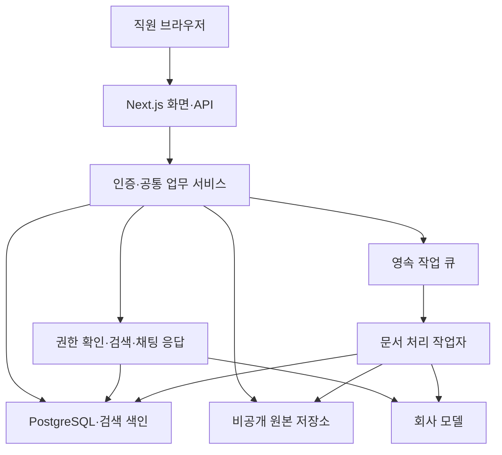

# 회사용 도메인 위키 — 통합 구현 계획

계획 개정: 2026-09-08 / 2차 전체 재설계. 구현 상태 갱신: 2026-09-09.

대상: `/Users/jikime/Dev/Private/my-domain-wiki`

상태: 사용자 지시에 따라 추가 승인 없이 1~8단계 화면·기능을 순서대로 구현했고 전체 통합시험 70개와 단계별 실제 브라우저 확인을 통과했다. 로컬 운영 이미지·백업·복구도 검증했다. 실제 회사 모델·고객 문서·기관 자료·팀 인수 및 외부 배포는 입력 대기다. [최종 구현·검증 결과](./COMPLETION.md)를 기준으로 확인한다. 이전 단계 번호는 이 문서로 대체한다.

작업 단위와 완료 조건: [실행 작업 목록](./IMPLEMENTATION_BACKLOG.md)

원본 `llm_wiki`의 자동 위키 구축·갱신·그래프 검색·품질 점검을 보완할 후속 범위: [9~16단계 계획](./CORE_FEATURE_PLAN.md).

## 1. 제품의 목적

회사의 규정·업무 지식·프로젝트 경험을 회사가 보유하고, 직원이 위키를 탐색하거나 채팅으로 질문해 업무에 활용하는 웹 서비스를 만든다.

| 흐름 | 직원이 하는 일 | 시스템이 해야 하는 일 |
| --- | --- | --- |
| 지식 활용 | 질문, 후속 질문, 위키 탐색, 원문 확인 | 허용된 위키·자료 검색, 근거가 있는 답변, 대화 보관 |
| 지식 축적 | 자료 등록, 경험 작성, AI 초안 검토 | 원문 보존, 도메인별 정리, 근거 연결, 버전·게시 관리 |
| 지식 유지 | 오류 신고, 규정 개정 확인, 자료 철회 | 영향받는 지식 확인, 수정안·재검토, 검색·대화 접근 갱신 |

도메인 위키는 회사 지식의 기준이며, 채팅은 직원이 그 지식을 이용하는 주요 방법이다. 두 기능을 첫 제품의 필수 기능으로 다룬다. RFP 검토는 축적된 지식을 사용하는 후속 업무 기능이다.

## 2. 재분석 결과

| 이전 계획의 부족한 점 | 이번 계획의 조정 |
| --- | --- |
| 채팅이 검색 기능에 묶였다가 별도로 추가됨 | 처음부터 직원 채팅을 핵심 사용 흐름·메뉴·데이터·검증 대상으로 설계 |
| 위키 채팅과 원본 연결의 개발 순서가 떨어져 있음 | 첫 채팅부터 게시 위키와 공개된 원본을 함께 이용하도록 자료 처리를 앞에 배치 |
| 기능별 단계가 길어 실제 업무 흐름의 완성이 늦음 | 1~3단계에서 자료 등록·위키 게시·직원 채팅을 작게 연결해 시연 |
| 전체 자동화가 준비되어야 사용 가능해 보임 | 간단한 위키 작성·단일 페이지 승인부터 시작하고 AI 생성·일괄 검토 확장 |
| 고객 문서의 복잡한 표·이미지 평가가 뒤에 있음 | 1~2단계에서 대표 문서와 파서를 평가하고 필수 형식을 조기에 확정 |
| 권한과 변경 영향이 후반에 집중됨 | ID·버전·공개 상태·권한 경계를 처음부터 적용하고 운영 절차를 후반에 검증 |
| 제안 도구가 확정 요구처럼 보일 여지가 있음 | 사용자 결정, 현재 환경, 구현 기본안, 미확정 사항을 구분 |

### 확인한 현재 코드

- 새 프로젝트에는 Next.js 16.3.4, React 19.2.8, TypeScript, Tailwind CSS 4, Biome, npm, shadcn/ui 기본 구성이 있다. 현재 화면은 시작 화면이다.
- DB·인증·직원 채팅·업무 데이터·문서 작업자는 아직 없다. 기존 패키지·레이아웃·스타일의 작업 중 변경은 보존한다.
- 이번 작업은 분석과 계획 문서 수정이다. 새 앱의 빌드·실행, 고객 문서 품질, 다중 사용자 동작은 검증 완료로 간주하지 않는다.
- 참조 앱은 `/Users/jikime/Dev/Private/Experimental/llm_wiki`, 패키지 버전 0.6.11이다. 이번 확인 시 Git HEAD는 `8bcf9b5`였다. 실제 파일을 옮길 때 참조 버전·내용을 다시 기록한다.
- 참조 앱의 수집 로직은 파일 명령과 화면 상태 저장소에 연결되어 있고, 위키 파일 저장 후 Review 등록·임베딩 갱신을 수행한다. 그대로 옮기면 게시 승인 경계를 우회한다.
- 참조 앱의 채팅 에이전트는 조회 외에 위키 쓰기·셸·외부 조사 도구도 가진다. 회사 직원 채팅에는 필요한 검색·읽기 경로만 가져온다.
- PDF·Office 처리는 Rust와 네이티브 라이브러리에 의존하는 부분이 있다. React 화면만 옮겨서는 문서 처리가 되지 않는다.
- 현행 키워드 검색에는 한자권 문자열 분해 처리가 있다. 이 사실을 한국어 업무 검색 품질의 증거로 삼지 않는다.

## 3. 결정사항과 첫 출시 범위

사용자가 정한 기준:

- 새 제품은 `my-domain-wiki`에서 Next.js 웹으로 만든다.
- PostgreSQL을 회사의 업무 데이터 중앙 저장소로 사용한다.
- 기존 소스는 고객 요구에 맞게 선택적으로 재사용·수정·교체한다.
- 직원 채팅, 도메인 위키, 회사 공동 활용을 필수로 한다.
- 개인 데스크톱 편의 기능과 업무에 불필요한 에이전트 실행 기능을 줄인다.

첫 출시는 한 회사의 한 팀이, 참여자에게 공유가 승인된 자료를 사용하는 공용 작업공간 하나로 시험 운영한다는 기본안이다. 업무 프로젝트와 발주처 구분은 처음부터 데이터로 둔다. 여러 고객사를 한 서비스에서 운영하는 과금·조직 관리 기능은 만들지 않는다.

| 요구 ID | 첫 출시 요구 | 구현 단계 |
| --- | --- | --- |
| R01 | 직원 로그인·역할·공용 작업공간 | 1 |
| R02 | 도메인 목적·용어·양식, 발주처·프로젝트·적용 범위 | 1, 4, 5 |
| R03 | 원본 등록·버전·처리 상태·추출 결과·근거 위치 | 2 |
| R04 | 위키 작성·편집·버전·검토·게시·관련 페이지 | 2, 4, 5 |
| R05 | 직원 채팅·후속 질문·대화 기록·스트리밍·중지 | 3 |
| R06 | 위키·원본 검색, 범위 선택, 출처 확인·근거 부족 표시 | 2, 3, 5 |
| R07 | 짧은 실무 기록과 작성자·검토자·근거 | 4 |
| R08 | AI 분석·지식 초안·변경 제안·검토 후 반영 | 4 |
| R09 | 오류 신고·검토함·중복·모순·개정 재검토 | 3, 4, 6 |
| R10 | 업무 입문 홈·자료실·작은 관계 탐색 | 1, 5 |
| R11 | 중앙 모델 설정·작업 운영·비용·사용량 확인 | 1, 2, 3, 6 |
| R12 | 접근 철회·삭제·이관·백업·복원·운영 안내 | 1~3, 6, 7 |
| R13 | 승인된 공식 자료 보완·대표 RFP 검토 | 후속 8 |

첫 출시에 포함하지 않을 기능: 범용 셸 실행, 개인 CLI·Skill 탐색, 자유로운 외부 조사와 자동 게시, AnyTXT, 트레이·자동 시작, Obsidian 자동 설정, 개인용 템플릿, 고급 전체 그래프 분석, 영상·음성·전자책, 브라우저 확장·MCP 설정.

사내 SSO·NAS 연결·부서별 제한 공간은 고객 환경이 확인되면 확장한다. 제한 자료를 넣기 전에 해당 접근 통제를 먼저 구현한다. 자료의 원문 보기와 다운로드도 서버 권한 확인을 거친다.

## 4. 직원 화면과 실제 사용 흐름

| 메뉴 | 제공할 행동 |
| --- | --- |
| 도메인 홈 | 핵심 개념·업무 절차·최근 게시 지식 확인, 바로 질문 |
| 직원 채팅 | 질문·후속 질문, 대화 목록, 자료 범위 선택, 근거 확인 |
| 도메인 위키 | 지식 읽기·찾기·관련 자료 보기, 이 위키에 질문, 수정 제안 |
| 자료실 | 원문 등록·분류·미리보기·버전·처리 상태 확인, 이 자료에 질문 |
| 실무 기록 | 상황·확인 사실·수정 이유·적용 범위·다음 확인 질문 기록 |
| 검토함 | 게시 변경안, 질문에서 접수한 오류, 모순·개정 영향 검토 |
| 관리 | 직원·역할·도메인·모델·작업·운영 설정 |

검색은 위키·자료실·채팅에서 공유하는 기능으로 제공한다. 작업 진행은 자료실과 관리자 화면에서 확인한다. 메뉴는 직원의 역할과 구현 상태에 맞게 보여준다.

채팅 화면은 대화 목록, 질문·답변, 근거 패널로 구성한다. 좁은 화면에서는 근거 패널을 별도로 열 수 있게 한다. 모델 이름·토큰 설정을 직원의 첫 선택 항목으로 두지 않는다.

**지식 활용:** 로그인 → 도메인 선택 → 질문 → 위키·원문 검색 → 근거가 있는 답변 → 원문 위치 열기 → 후속 질문.

도메인 전체, 특정 업무 프로젝트, 선택한 위키·자료로 질문 범위를 좁힌다. 최초에는 선택한 자료가 이미 등록·공개·추출되어 있어야 한다. 채팅에서 파일을 추가하는 편의 기능은 자료실과 같은 등록 절차로 연결하며, 공개·검토를 우회하지 않는다.

**지식 축적:** 원문 또는 실무 경험 등록 → 도메인·프로젝트·자료 유형 지정 → AI 초안 또는 직접 작성 → 검토·수정 → 게시 → 다른 직원이 검색·채팅에 활용.

**오류·변경 처리:** 답변 오류 신고 또는 원문 개정 → 영향받는 위키·근거 확인 → 변경안 작성 → 검토·새 버전 게시 → 검색 갱신.

## 5. 구조와 기술 선택

초기에는 한 저장소 안에 Next.js와 업무 서비스를 두고, 문서 처리 작업자만 별도 프로세스로 실행한다. 인증·검색·검토를 각각 독립 서비스로 쪼개지 않는다.

| 영역 | 기본안 | 상태·이유 |
| --- | --- | --- |
| 웹·API | 현재 Next.js App Router, Node.js | 확정된 기반. 설치된 버전의 로컬 문서를 따른다 |
| UI | 현재 React·Tailwind CSS·shadcn/ui | 기존 구성을 활용 |
| 업무 저장 | PostgreSQL | 사용자 결정. 본문·메타데이터·버전·대화·권한 저장 |
| DB 접근 | Drizzle + node-postgres | 구현 제안. 마이그레이션과 트랜잭션 사용 |
| 인증 | Better Auth | 구현 제안. 관리자 계정 제공·서버 세션부터 시작 |
| 벡터 검색 | pgvector | 기본 설계안. 검색 성능·한국어 품질은 별도 평가 |
| 작업 큐 | pg-boss + 별도 TypeScript 작업자 | 구현 제안. PostgreSQL을 활용해 초기 운영 구성 축소 |
| 원본 저장 | 비공개 영속 파일 저장소와 저장소 인터페이스 | 제안. 개발은 전용 디렉터리, 운영은 영속 볼륨 또는 객체 저장소 |
| 파서 | 공통 추출 형식 + 필요한 기존 Rust 파서 분리 | 표본 평가 후 결정. 전체 Rust 재작성은 목표가 아님 |
| 모델 | 회사가 지정한 서버 모델 연결 | 공급자·모델·키는 미확정. 직원 PC 설정에 의존하지 않음 |

제안 도구의 호환 버전은 1단계에서 확인·고정한다. 새 도구를 실제로 설치한 상태로 표현하지 않는다. 원본 바이너리는 저장 키·해시·버전을 DB에 연결해 보관하는 안이다. 바이너리까지 DB에 넣을지는 자료 크기·백업 조건을 확인해 확정한다.

서버 컴포넌트는 서버 서비스를 직접 호출하고, 브라우저 호출은 API 또는 Server Action에서 같은 서비스를 사용한다. 채팅 스트리밍은 전용 API에서 처리한다. 모든 경로에서 소속·권한·공개 상태를 검증하며 UI나 Proxy만으로 접근을 제한하지 않는다.

문서 추출·AI 수집·임베딩은 작업자가 실행한다. 작업 등록과 데이터 변경은 트랜잭션 또는 아웃박스로 연결한다. 재시도는 원본 버전·처리 단계·설정 버전에 따른 중복 방지를 적용한다. 외부 AI 호출까지 항상 한 번만 실행된다고 가정하지 않는다.

원문과 검색 결과는 모델이 참고할 데이터로 취급한다. 문서 안의 지시문이 권한·도구 실행·게시 정책을 바꾸지 못하도록 한다. 직원 채팅은 검색·읽기를 기본으로 하며, 지식 저장 요청은 검토할 변경안으로만 연결한다.

## 6. 데이터와 권한의 기본 규칙

| 데이터 | 핵심 관계 |
| --- | --- |
| 작업공간·소속·역할 | 직원이 어느 회사 공간에서 어떤 작업을 하는가 |
| 도메인·발주처·업무 프로젝트 | 공통 지식과 특정 사업 경험의 적용 범위 |
| 원본·원본 버전 | 문서 ID, 저장 키·해시, 발행·시행·수집 시점, 공개 상태 |
| 추출·청크 | 원본 버전, 문단·페이지·표·슬라이드 위치, 파서·설정 버전 |
| 위키 페이지·버전 | 안정적인 페이지 ID, 마크다운 본문, 현재 게시 버전 |
| 변경안·검토 결정 | 기준 게시 버전, 제안 버전, 검토자·결정·이유 |
| 근거·관계 | 주장과 원본 구절, 위키·원본 버전, 적용 범위, 추정·검토 여부 |
| 실무 기록 | 작성자 진술, 상황·변경 이유·다음 질문, 근거·검토 상태 |
| 대화·메시지·실행 | 소유 직원, 선택 범위, 질문·답변, 진행·중단·완료, 요청 ID |
| 답변 인용 | 메시지와 사용한 원본·위키 버전·근거 위치 |
| 작업·피드백·감사 | 작업 시도, 오류 신고, 변경 주체·시점, 사용량 |

파일명·폴더 경로 대신 고정 ID로 연결한다. 원문이 개정되면 새 버전을 만들고 과거 근거를 덮어쓰지 않는다. 마크다운은 DB 본문 형식으로 유지하며 내보내기를 지원한다.

상태는 다음과 같이 분리한다.

- 원본 처리: 대기·처리 중·완료·실패. 파싱 실패를 빈 문서의 성공으로 기록하지 않는다.
- 원본 공개: 검토 대기·공개·철회. 추출 성공과 직원 공개는 별개이다.
- 위키 변경안: 초안·검토 대기·승인·반려·철회. 특정 버전을 승인하며 수정 후 과거 승인을 재사용하지 않는다.
- 검색 준비: 키워드·벡터 색인 상태. 공개 상태와 색인 상태를 혼동하지 않는다.
- 대화 응답: 생성 중·완료·중단·실패. 부분 응답을 완료 답변으로 표시하지 않는다.

게시 시 게시 버전과 감사 기록을 트랜잭션으로 변경한다. 새 초안이 기존 게시본을 덮어쓰지 않는다. 기준 버전이 바뀌면 충돌을 표시하고 재검토한다. 여러 페이지 일괄 승인은 단일 페이지 흐름이 동작한 뒤 추가한다.

| 역할 | 기본 권한 |
| --- | --- |
| 이용 직원 | 허용된 위키·원본·실무 기록 조회, 검색·채팅, 오류 신고 |
| 작성 직원 | 이용 권한 + 자료 등록·경험 작성·위키 변경안 제출 |
| 검토 직원 | 작성 권한 + 자료 공개·게시 승인·반려·철회 |
| 관리자 | 이용·작성·검토 전체 권한 + 계정·역할·모델·운영 설정 |

2026-09-09 사용자 요청 반영: [업무 권한 체크 선택과 관리자 전체 권한](improvements/04-member-permissions/README.md)을 적용한다. 검토에는 작성이 포함되며 관리자 지정만으로 모든 업무 권한을 갖는다.

대화는 기본적으로 본인에게만 보인다. 관리자 역할만으로 직원 대화를 자동 열람하게 만들지 않는다. 초안은 권한이 있는 작성자·검토자의 검토 화면에서 확인한다. 자기 승인은 초기에는 막는 것을 제안하며 실제 운영 역할에 맞춰 확정한다.

검색·채팅은 현재 허용된 게시 위키와 공개된 원본·경험만 사용한다. 원문 조회·청크·관계·내보내기에도 같은 정책을 적용한다. 한 근거의 접근이 철회되어 파생 지식에 제한 자료가 섞였다면 해당 지식도 조회를 제한하고 재검토한다.

권한 철회는 다음 조회·후속 질문·다운로드 시 적용한다. 진행 중 답변도 권한 변경 시 취소·출력 중단 여부를 재확인한다. 이미 전송된 내용이나 다운로드 사본까지 회수한다고 약속하지 않는다. 과거 대화의 제한된 근거·파생 답변을 다시 모델 문맥에 넣지 않는다.

## 7. 구현 순서와 첫 완성 목표

첫 기능 완성 목표:

> 작성 직원이 실제 자료를 등록하고 근거를 연결한 짧은 위키를 제출한다. 검토 직원이 승인하면 다른 직원이 채팅으로 업무를 질문하고 위키와 원문 위치를 열어 답변을 확인한다. 다시 접속해서 후속 질문을 이어간다.

처음 몇 개 위키는 수동으로 작성해 자료·게시·채팅 경로를 검증한다. 4단계에서 AI가 같은 변경안 구조를 채우게 한다. 3단계 시연은 중간 성과이며 AI 지식 축적과 운영 검증까지 마쳐야 첫 출시가 완료된다.

| 단계 | 사용자에게 확인할 결과 | 필요한 구현 | 종료 기준 |
| --- | --- | --- | --- |
| 1. 공용 서비스 기반 | 로그인하고 도메인 홈·채팅 진입점을 본다 | 기준 확인, DB·마이그레이션, 계정·소속·역할, 한국어 화면, 모델 설정 기반 | 두 계정의 역할을 실제 DB에 저장. 미구현 기능은 준비 중으로 표시 |
| 2. 근거가 있는 지식 등록 | 실제 자료와 게시 위키를 읽고 원문을 확인한다 | 업로드·버전·공개, 작업자·파싱, 기본 색인, 위키 편집·단일 페이지 승인 | 원문 위치와 게시본 연결. 비공개 자료·초안의 일반 조회 제외 |
| 3. 직원 채팅 완성 | 위키·원본에 질문하고 출처를 확인하며 대화를 이어간다 | 범위 선택, 공통 검색, 스트리밍, 메시지·인용 저장, 중지·재시도·피드백 | 다른 직원 계정으로 실제 모델 질의·근거 열기·후속 질문·재접속 시연 |
| 4. AI와 경험으로 지식 축적 | 자료·메모에서 AI 초안을 받아 검토 후 회사 지식으로 쌓는다 | 단계별 수집, 실무 기록, 변경 비교·병합·일괄 검토, 승인 후 색인 | 새 자료·경험이 검토를 거쳐 채팅에 반영됨 |
| 5. 업무 탐색·문서 품질 | 처음 맡은 업무의 규정·사례·질문을 찾는다 | 도메인 홈 완성, 관계 탐색, 프로젝트 필터, 한국어 검색·표·이미지 보완 | 고객 필수 문서 형식과 질문으로 품질 기준 충족 |
| 6. 변경과 공동 운영 | 개정·오류·철회를 처리하고 작업 실패를 복구한다 | 변경 영향, 검토함 정리, 작업 관측·재처리, 비용·동시성 제한, 보존·삭제 | 개정·철회·작업 재시작·동시 수정 시나리오 통과 |
| 7. 이관·배포·팀 시험 | 팀이 실제 자료로 독립적으로 사용한다 | 자료 이관, 원본·DB 복원, 배포·운영·평가 안내 | 별도 환경에 복원하고 신규 자료·질문으로 담당자가 운영 |
| 8. 후속 업무 확장 | 공식 자료 후보와 RFP 검토안을 활용한다 | 승인 사이트 조사, 발행·적용 정보, 대표 RFP 양식 | 직원 검토 결과로 업무 효과 확인 후 범위 확대 |

권한 검사를 6단계까지 미루거나 고객 문서 평가를 5단계에서 처음 시작하지 않는다. 5~7단계는 초기부터 구현한 규칙을 실제 품질과 운영 조건에서 완성하는 단계이다.

## 8. 직원 채팅의 구체적인 동작

1. 로그인 직원과 대화 소유권·질문 범위를 확인한다.
2. 후속 질문이면 이전 대화로 질문 의미를 해석한다. 이전 AI 답변을 독립적인 근거로 쓰지 않는다.
3. 현재 허용된 위키·원본·경험을 검색한다. 선택 범위 밖 자료를 임의로 섞지 않는다.
4. 원문 버전·근거 구절·페이지·적용 범위를 포함해 답변 문맥을 구성한다.
5. 모델이 업무 설명과 인용을 생성한다. 공식 기준·사례·직원 진술·추론을 구분한다.
6. 인용 ID와 위치가 실제 제공한 근거에 있는지 검증한다. 링크 존재만으로 내용의 정확성을 보장하지 않는다.
7. 직원은 근거 패널에서 위키 문단·원문 위치를 열고 후속 질문한다.
8. 질문·응답·상태·모델·사용량·근거 버전을 DB에 저장한다. 오류 신고는 메시지·근거와 함께 검토함으로 접수한다.

위키만 읽었으면 위키 인용으로 표시한다. 실제 원문을 가져오지 않았는데 원문까지 검증했다고 표현하지 않는다. 공식 자료의 발행 기관만으로 의무 여부를 단정하지 않는다. 근거가 부족하면 확인된 부분과 추가 확인 사항을 나눈다.

스트리밍 중 텍스트와 검증된 인용 상태를 구분한다. 중지·연결 종료 시 부분 응답은 중단 상태로 보존한다. 요청 ID로 이중 전송을 처리하고, 사용자가 재시도하면 새 실행임을 기록한다. 모델 키가 없으면 모의 검증만 가능하며 채팅 완료로 표시하지 않는다.

## 9. 파서·검색·평가 전략

최초 검증용 TXT·MD·텍스트 PDF를 연결하되 1~2단계부터 복잡한 PDF, PPTX 화면설계서, DOCX 표 문서를 평가한다. 고객 필수 형식은 첫 출시 전에 지원한다. XLSX·HWP/HWPX의 필요 여부는 확인할 항목이며 현재 지원 사실로 간주하지 않는다.

추출 결과에는 텍스트와 위치를 보존한다. PDF는 페이지와 가능한 영역, PPTX는 슬라이드·도형, DOCX는 문단·표 위치를 사용한다. 페이지가 고정되지 않는 문서에 임의 페이지 번호를 붙이지 않는다. OCR·이미지 해석이 필요하면 추가하고 누락 영역을 성공으로 감추지 않는다.

한국어는 전문용어·동의어·약어·조사·한영 혼용으로 평가한다. 초기에는 명칭 검색을 제공하고 pgvector와 결합한다. 근사 검색의 필터링 때문에 허용된 자료가 누락되지 않는지도 확인한다. 작은 자료 규모에서는 정확한 벡터 검색부터 시작하고 근사 색인은 필요할 때 추가한다.

평가 자료에는 원문, 질문, 기대 근거 위치, 적용 범위, 답할 수 없는 질문을 함께 기록한다. 실제 자료가 없으면 별도 표본으로 개발 검증을 하되 고객 품질 통과로 기록하지 않는다.

| 평가 | 완료 판단 |
| --- | --- |
| 자료 추출 | 표·부정문·예외·단위와 위치 보존을 형식별로 확인 |
| 검색 | 기대 근거 검색률과 범위 필터를 고정 질문으로 비교 |
| 답변 | 핵심 주장과 근거의 일치, 적용 범위, 근거 부족 응답을 직원이 평가 |
| 권한·게시 | 다른 직원·역할·공간으로 접근을 시도한 시험에서 초안·자료·대화 노출 0건 |
| 생성·검토 | 초안이 직접 게시되지 않으며 충돌·반려·수정 후 재검토 동작 |
| 운영 | 중복 작업·중단·재시작·복원의 자료 유실·중복 게시가 없음 |
| 업무 효과 | 지식을 찾는 시간, 유용한 답변 비율, 검토 수정 부담 측정 |

정확도·응답 시간·동시 사용량의 수치 목표는 대표 자료와 모델을 확보한 후 기준 측정과 함께 정한다. 중대한 근거 반전·접근 우회는 해결 후 재평가한다. 통과한 시험이 모든 문서의 무오류를 보장한다고 표현하지 않는다.

## 10. 기존 코드 재사용과 새 코드 경계

| 기존 코드 | 처리 |
| --- | --- |
| `src/components/editor/` | 편집·읽기 UI 선택 재사용, 저장은 페이지·버전 ID로 변경 |
| `src/components/chat/` | 메시지·인용 UI 재사용, 개인 파일·Skill·셸 경로 제외 |
| `src/lib/ingest.ts`, 해석·정제 모듈 | 프롬프트·검증 로직 추출, 화면 상태·파일 쓰기 분리 |
| `src/lib/llm-client.ts`, 공급자 모듈 | 필요한 요청·스트리밍 처리 참고, 서버 전용으로 이전 |
| `src/lib/ingest-queue.ts` | 취소·재시도 참고, 큐와 상태는 서버 DB로 교체 |
| 템플릿·그래프 모듈 | 도메인 설정과 작은 관련 보기 중심으로 활용 |
| Rust 문서 파서 | 실제 표본 평가 후 분리·재사용 또는 교체 |
| `src/commands/fs.ts`, 로컬 프로젝트 저장소 | 파일 경로 API 대신 업무 서비스 새 구현 |
| Rust 에이전트·HTTP 서버 | 검색 경험 참고. Tauri AppHandle·공유 토큰 구조를 그대로 옮기지 않음 |
| LanceDB 코드 | 검색 인터페이스를 기준으로 pgvector 구현으로 대체 |

전역 화면 저장소를 서버 공용 상태로 가져오지 않는다. 문서·대화·설정의 기준 상태는 DB에 두고 화면은 조회 결과와 입력 상태를 관리한다. 브라우저 전용 편집기·그래프는 클라이언트 경계에서 사용한다.

제안 구조: `src/app`, `src/features`, `src/components`, `src/server/{auth,db,services,storage,parsers,retrieval,chat,ai,jobs}`, `src/worker`, `drizzle`, `tests`, `docs`. 필요한 기능을 구현할 때 디렉터리를 만든다.

## 11. 이관과 운영

기존 자료가 있다면 읽기 전용 조사·변환 예고부터 시작한다. 경로를 문서 ID에 매핑하고 해시·문서 수·링크·근거를 검증한다. 재실행해도 중복되지 않도록 이관 기록을 남긴다. 회사 승인 기록이 없는 기존 위키는 검토 대기로 가져오는 것을 기본으로 한다.

운영 구성은 Next.js 웹, 작업자, PostgreSQL, 비공개 영속 원본 저장소를 기본으로 한다. 배포 위치는 미확정이다. 네이티브 파서 의존성과 작업 프로세스를 고려해 실행환경을 정한다.

DB와 원본 버전 목록·파일을 함께 복원해야 한다. 공개 철회와 물리 삭제를 구분하고 이력·백업 보존 기간에 따라 파일을 정리한다. 실패 시 기존 게시본을 유지하는 배포·마이그레이션 절차를 문서화한다.

## 12. 미확정 사항과 결정 시점

| 항목 | 현재 기본안 | 확인 시점 |
| --- | --- | --- |
| 대표 도메인·문서·질문 | ITS·교통관제는 제안서 예시이며 실제 범위 확인 필요 | 1~2단계. 자료가 없으면 고객 검증 미완료 표시 |
| 필수 형식·크기 | PDF·PPTX·DOCX 중심 가정 | 1~2단계 파서 평가 전 |
| 모델·임베딩·키 | 회사 지정 서버 모델 | 3단계 실제 채팅 이전 |
| 로그인 방식 | 관리자 계정 제공, 공개 가입 없음 | 1단계. SSO가 필수면 앞당김 |
| 첫 팀·권한 범위 | 공유 승인 자료를 사용하는 한 공간 | 1단계. 제한 자료 등록 전에 정책 확대 |
| 원본 저장·배포·백업 | 개발 전용 저장소, 운영 영속 저장소 | 인터페이스는 2단계, 운영 위치는 7단계 전 |
| 검토 책임자·주기 | 담당 검토자, 단일 페이지 승인부터 | 2단계. AI 도입 시 적체·수정 부담 측정 |
| 규모·속도·비용 | 수치 미정 | 초기 채팅·파싱 측정 후 7단계 이전 |

미확정 사항 때문에 독립적인 개발을 멈추지 않는다. 필요한 입력이 없는 기능은 검증 수준을 기록하고 다음 독립 작업을 진행한다. 모델·문서 품질을 모의 데이터만으로 통과 처리하지 않는다.

## 13. 참고 근거와 다음 작업

코드 사실은 현재 두 프로젝트의 파일을 기준으로 확인했다. Next.js 구현 시 대상 프로젝트 `AGENTS.md`와 설치된 `node_modules/next/dist/docs/`를 우선 읽는다.

- [Next.js 서버·클라이언트 안내](https://nextjs.org/docs/app/getting-started/server-and-client-components), [서버 API와 실행환경 제약](https://nextjs.org/docs/app/guides/backend-for-frontend)
- [Drizzle PostgreSQL 안내](https://orm.drizzle.team/docs/get-started/postgresql-new)
- [Better Auth Next.js 연결](https://better-auth.com/docs/integrations/next)
- [pg-boss](https://github.com/timgit/pg-boss), [pgvector](https://github.com/pgvector/pgvector)

현재 **1~6단계 기능과 7단계 로컬 배포·복구 검증을 마치고 8단계를 진행한다.** 실제 모델·고객 문서가 필요한 품질 판정은 입력 대기다. [2단계 기능·실행 안내](./stages/02-knowledge/README.md), [검증 결과](./stages/02-knowledge/VERIFICATION.md), [파서 비교](./stages/02-knowledge/PARSER_EVALUATION.md)를 참고한다. 단계별 추가 승인 없이 구현·검증을 진행한다. 각 단계는 작업 목록의 완료 증거가 확보될 때만 완료로 바꾼다.

6단계 완료 기록: [개정·운영 기능](./stages/06-operations/README.md) · [58개 시험과 개발 화면 검증](./stages/06-operations/VERIFICATION.md). 7단계 로컬 배포·복구 결과는 [검증 기록](./stages/07-deployment/VERIFICATION.md)에 남겼다. 실제 팀 인수 판단은 입력 대기이며, 사용자 지시에 따라 8단계 구현·검증을 추가 승인 없이 진행한다.
