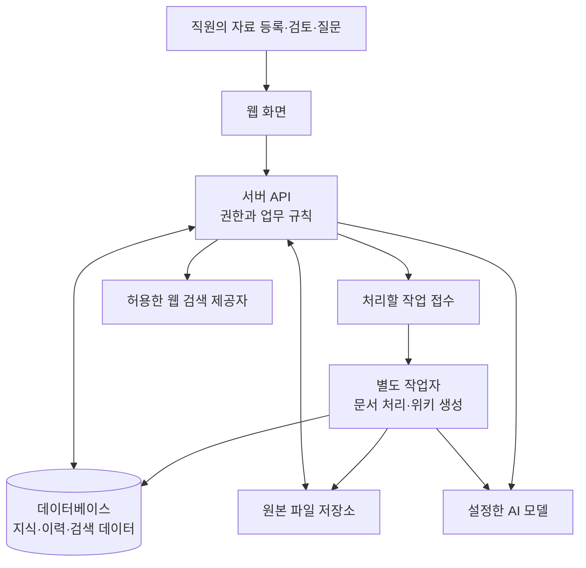

# AI 스타터킷 기반 도메인 지식 서비스 개선·운영 교육 제안서

**작동하는 서비스를 이해하고, 회사의 지식과 업무를 담아, 직원의 손으로 계속 발전시키는 교육**

| 구분 | 제안 내용 |
| --- | --- |
| 제안 대상 | 엠큐닉 UX·기획·AX 관련 직원 및 도메인 실무 담당자 |
| 제안 및 강의 | 김동학 · Anthony Kim |
| 교육 대상의 특성 | AI를 활용해 여러 구현을 시도한 경험이 있으며, 결과의 완성·오류 해결·업무 적용을 위한 도움이 필요한 직원 |
| 교육 형태 | 구현된 스타터킷을 활용한 실습, 회사 도메인 적용, AI 개발 코칭, 결과 리뷰 |
| 교육 기간 | 10주, 주 1회 3시간, 총 30시간 |
| 참여 규모 | 5명 내외, 권장 4~6명 |
| 제공 기반 | `my-domain-wiki`의 자료·위키·검색·채팅·검토·업무 활용 기능과 소스 코드 |
| 교육 성과 | 회사 도메인에 적용한 서비스, 직원의 개선·검증 경험, 교육 이후에도 이어지는 코드·지식·평가 자산 |
| 문서 상태 | 고객 검토용 제안 초안 v2.0 |
| 작성일 | 2026년 9월 10일 |

> 구현된 도메인 위키 스타터킷을 제공하고, 직원이 실제로 사용하면서 구조와 개발 원리를 이해하도록 돕습니다. 이어 회사 자료와 업무 기준을 적용하고, 필요한 지식을 찾아 AI와 함께 작은 개선을 수행합니다. 교육 이후에도 같은 코드와 데이터를 사용하면서 새로운 문제를 진단하고, 변경 결과를 검증하며, 다음 개선을 이어갈 수 있는 역량을 확보합니다.

본 제안은 기존에 구현한 기능을 교육의 출발점으로 사용합니다. 교육생은 회사의 업무 요구 정의, 자료와 지식의 구성, 선택한 기능의 개선, 결과 검증을 직접 수행합니다. 강사는 수업 전에 교육용 실행 환경과 실습 자료를 준비하고, 수업 중에는 구조 설명·문제 진단·개발·검증을 코칭합니다.

스타터킷의 개발 표본 검증, 교육생 환경에서의 실행 재현, 고객 자료의 업무 적합성은 각각 확인합니다. 세부 실습 과제와 제공 버전, 준비 범위, 운영 조건과 비용은 착수 시 확정합니다.

## 1. 교육의 배경과 접근 방향

귀사는 ITS·교통관제 등 여러 사업 분야에서 요구사항 분석, 서비스 기획, 화면설계와 관련 업무를 수행하고 있습니다. 이 과정에서 공식 문서, 발주처 특성, 프로젝트별 판단과 수정 이유를 다음 업무에 다시 활용할 수 있는 지식 기반이 필요합니다.

참여 직원이 가진 AI 활용 경험은 교육의 출발점입니다. 사전 진단에서는 이전에 만들고자 했던 결과, 현재까지 구현한 내용, 반복해서 막힌 지점을 확인합니다. 다음 항목은 진단할 문제의 예시이며, 직원별 어려움은 실제 사례를 통해 파악합니다.

| 사전 진단 항목 | 교육에서 연습할 방법 |
| --- | --- |
| 원하는 결과를 AI에게 설명하기 어려움 | 업무 문제를 입력·기대 결과·수정 범위·완료 기준으로 구체화 |
| 코드는 생성되지만 실행하거나 연결하기 어려움 | 화면·서버·데이터·외부 서비스의 연결 위치와 실행 조건 확인 |
| 오류가 발생하면 무엇부터 봐야 할지 모름 | 재현 절차, 화면과 서버의 오류 기록, 설정과 데이터 상태를 순서대로 확인 |
| AI의 수정이 맞는지 판단하기 어려움 | 변경 내역을 읽고 같은 입력의 전후 결과와 영향받는 기능을 비교 |
| 예제를 다른 업무에 적용하기 어려움 | 공통 기능과 도메인별 자료·용어·양식·판단 기준을 구분 |
| 수업이나 시연 이후 개발이 이어지지 않음 | 같은 저장소에 변경 이유·참고 자료·평가 사례·다음 과제를 누적 |

30시간 동안 한 개의 도메인과 소수의 개선 과제에 집중합니다. 교육의 깊이는 직원이 필요한 부분을 찾고, AI의 도움으로 수정하고, 그 결과를 설명할 수 있는 수준으로 설정합니다. 복잡한 인증 체계나 대규모 기반 구조 변경은 기술 담당자와 함께 판단하는 후속 과제로 다룹니다.

## 2. 교육 목표와 고객이 확보할 성과

### 2.1 교육 후 직원이 수행할 일

1. 스타터킷에서 자료 등록부터 위키 검토·검색·답변까지의 흐름을 직접 실행하고 설명합니다.
2. 회사 도메인에 맞는 용어, 자료 분류, 지식 양식과 평가 질문을 정의합니다.
3. 문제가 발생한 위치를 화면·설정·데이터·처리 과정·AI 결과로 나누어 확인합니다.
4. 공식 문서와 검토된 업무 자료에서 필요한 지식을 찾고, 현재 과제에 적용할 수 있는지 판단합니다.
5. AI에게 범위를 제한한 변경을 요청하고, 변경 내용과 결과를 확인한 뒤 저장소에 반영합니다.
6. 새로운 문서나 질문에서도 같은 개선 절차를 적용하고, 다음 담당자가 이어갈 수 있도록 기록합니다.

### 2.2 교육 종료 시 회사에 남는 결과

| 성과 | 구체적인 결과 |
| --- | --- |
| 회사 도메인에 적용한 서비스 | 선정 자료·용어·위키 양식·업무 사례를 반영한 스타터킷 |
| 직원이 수행한 개선 | 공통 개선 과제와 팀 선택 과제의 변경 내역, 검증 결과, 되돌리는 방법 |
| 검토된 지식과 평가 자료 | 원문과 연결된 위키·실무 경험, 질문·기대 근거·실행 결과 |
| 개발 방법에 대한 이해 | 서비스 구조도, 수정 위치 안내, 주요 용어, 오류 진단과 자료 탐색 기록 |
| 지속적인 운영·개선 기반 | 회사 관리 저장소, 역할 분담, 실행 안내, 우선순위와 완료 기준이 있는 후속 과제 |

직원별 독립 수행은 합의한 소규모 변경을 기준으로 평가합니다. AI와 공식 문서를 사용할 수 있으며, 무엇을 바꾸었고 어떻게 확인했는지는 직원이 설명해야 합니다. 회사의 실제 운영 공개 여부는 교육 성과와 별도로 검토합니다.

## 3. 제공하는 스타터킷과 교육생의 개선 범위

### 3.1 현재 구현된 기능

스타터킷은 다음 기능을 포함한 웹 기반 도메인 지식 서비스입니다. ‘필수 실습’은 모든 직원이 기본 흐름을 경험하는 범위이며, ‘선택 활용’은 회사 과제에 맞춰 일부를 사용하거나 개선하는 범위입니다.

| 제공 기능 | 현재 구현한 내용 | 교육에서 다룰 내용 |
| --- | --- | --- |
| 계정·작업공간·권한 | 로그인, 직원 역할, 작업공간, 도메인·프로젝트 관리 | 필수: 이용·작성·검토 역할과 자료 분류 범위의 차이 이해 |
| 자료 등록·원본 관리 | 파일과 여러 자료 가져오기, 원본·버전 보존, 처리 상태·재시도 | 필수: 대표 문서 등록, 추출 결과와 원문 대조, 실패 확인 |
| 위키 생성·검토·개정 | 문서 분석, AI 초안, 기존 위키와의 변경안, 직원 검토·게시, 개정 이력 | 필수: 회사 지식 양식 적용, 근거 확인, 동료 검토와 수정 |
| 검색·도메인 탐색 | 키워드·의미 결합 검색, 용어와 별칭, 도메인·프로젝트 범위, 입문 안내 | 필수: 약어·자연어 질문 비교, 필요한 근거를 찾지 못하는 원인 분석 |
| 근거 기반 채팅 | 개인 대화·후속 질문, 원문 인용과 출처 확인, 답변의 위키 초안 저장 | 필수: 주장·출처 대조, 근거 부족 질문, 저장한 초안의 검토 |
| 이미지 첨부·웹 검색 | 이미지가 포함된 질문, 검색 제공자 선택, 웹 출처와 발췌 보존 | 선택 활용: 모델·검색 설정과 자료 전달 범위 확인, 내부 근거와 웹 출처 구분 |
| 실무 경험 축적 | 상황·판단 이유·결과·추가 확인 사항 기록, 근거 연결, 지식 반영 | 필수: 회사 사례를 기록하고 다른 직원이 재사용할 수 있게 보완 |
| RFP 검토 지원 | 관련 근거·사례를 연결한 분석 초안, 확인 질문, 직원 검토·버전 관리 | 필수 업무 적용: 대표 요구사항 묶음에 적용하고 유용한 결과와 수정할 결과 구분 |
| 품질 점검·관계 탐색 | 끊긴 연결·개정 영향·지식 관계 확인, 점검 결과와 그래프 | 선택 활용: 반복되는 지식 품질 문제에 맞춰 점검·표시 방식 보완 |
| 자료 수집·이동·처리 운영 | 허용 기관 자료 수집, 심층 조사, 서버 폴더 감지, 프로젝트 이동, 작업 기록 | 선택 활용: 필요한 기능의 조건과 운영 방법 확인 |

구현과 검증 범위는 [프로젝트 구현 기록](COMPLETION.md)과 [후속 기능 기록](MISSING_FEATURE_STAGES.md)에 정리되어 있습니다. 고객 자료의 정확성과 교육생 PC에서의 실행은 별도 확인 대상입니다. 브라우저 웹 클리퍼와 MCP 외부 연결은 제공 기능에 포함하지 않습니다.

이미지 해석에는 이를 지원하는 모델이 필요하고, 웹 검색에는 검색 제공자 설정이 필요합니다. 검색 제공자는 작업공간별로 사용 범위를 정할 수 있습니다. 스캔 문서의 OCR과 복잡한 표 처리는 대표 자료와 추가 처리 구성의 품질을 확인한 뒤 실습에 포함합니다.

### 3.2 교육생이 직접 바꾸는 범위

| 변경 수준 | 교육생의 작업 예시 | 기본 교육에서의 위치 |
| --- | --- | --- |
| 자료·설정 개선 | 용어·별칭, 자료 분류, 도메인 목적, 위키 양식, 평가 질문 수정 | 모든 직원이 수행 |
| 소규모 코드 개선 | 입력 도움말·사례 안내, 결과 표시, 업무에 필요한 제한된 필터나 검토 보조 기능 보완 | 공통 실습 후 팀 선택 과제로 수행 |
| 처리 규칙 개선 | 특정 문서의 처리 결과 보완, 검색 조건·답변 지시문·RFP 출력 규칙 조정 | 사전 진단과 예상 소요 시간을 기준으로 선택 |
| 기반 구조·외부 연동 변경 | 전사 로그인, 새로운 저장 시스템, 복잡한 업무 연동, 대규모 처리 확장 | 교육 중 필요성과 변경 범위를 정리하고 후속 과제로 계획 |

공통으로 작은 변경 한 건을 완성한 뒤, 팀이 업무 가치가 있는 개선 한 건을 선택해 진행하는 것을 기본으로 합니다. 필수 과제를 마치고 시간이 남으면 추가 과제를 수행합니다. 기존 기능으로 해결할 수 있는 요구는 사용 방법과 설정을 먼저 확인합니다.

## 4. 스타터킷의 구조와 기술을 배우는 방법

### 4.1 한 건의 자료와 질문으로 이해하는 구조

직원은 문서 한 건을 등록하고, 처리 결과를 확인하고, 위키를 검토한 뒤 질문합니다. 강사는 각 단계에서 실제 화면과 관련 코드·데이터 위치를 함께 보여줍니다.



화면은 사용자의 입력과 진행 상태를 보여주고, 서버는 로그인·권한·업무 규칙을 확인합니다. 데이터베이스에는 자료 정보, 위키, 대화, 근거와 이력을 보관하고, 업로드한 원본 파일은 별도 저장소에서 관리합니다. 오래 걸리는 문서 처리와 위키 생성은 작업자가 수행하며, 웹 화면을 닫아도 작업 기록이 남습니다. 작업 대기열도 PostgreSQL을 사용합니다.

### 4.2 실제 구현에 맞춘 기술 구성

| 영역 | 스타터킷의 구성 | 교육생이 이해할 수준 |
| --- | --- | --- |
| 화면과 웹 서버 | Next.js·React·TypeScript | 화면과 서버 처리의 차이, 입력이 전달되는 경로, 수정할 파일 찾기 |
| 공통 화면 요소 | shadcn/ui 기반 컴포넌트 | 기존 입력창·버튼·선택창을 사용해 일관된 화면 개선 |
| 로그인 | Better Auth | 로그인 상태와 작업공간 역할이 기능 이용에 연결되는 방식 |
| 데이터 관리 | PostgreSQL·Drizzle ORM | 문서·위키·근거·이력의 관계, 저장 항목 변경 시 확인할 영향 |
| 원본 보관 | 서버 파일 저장소 | 원본과 추출·생성 결과의 구분, 원본과 DB를 함께 관리하는 이유 |
| 문서 처리 | 형식별 추출기, 일부 형식의 Rust 변환기, 선택적인 MinerU·이미지 해석 연결 | 원문과 처리 결과 대조, 지원 범위와 오류 확인 |
| 검색 | 키워드 검색·pgvector 기반 의미 검색·관계 정보 | 질문과 문서의 표현 차이, 범위 조건, 검색 결과 평가 |
| 긴 작업 | pg-boss·별도 작업자 | 작업 접수·처리·실패·재시도, 서버와 작업자의 설정 확인 |
| AI·웹 검색 연결 | 서버의 모델 호출·검색 제공자 어댑터 | 환경변수, 키와 모델 설정, 전달되는 자료, 응답과 오류 확인 |
| 변경과 검사 | Git, TypeScript·Biome, 기능별 검사와 브라우저 확인 | 변경 내역 보관, 필요한 검사 선택, 전후 비교와 복구 |

설명은 교육에 제공하는 코드와 버전을 기준으로 합니다. 외부 문서의 최신 예제를 적용할 때에도 현재 설치 버전과 맞는지 확인합니다. 원본 변환기 전체를 구현하거나 모든 기반 기술을 숙련하는 일은 30시간의 필수 과제로 두지 않습니다.

### 4.3 개념과 용어를 익히는 방식

API와 환경변수는 외부 서비스 연결을 확인할 때, 문서 분할과 임베딩은 검색 결과를 비교할 때, 버전과 마이그레이션은 변경의 영향을 살펴볼 때 설명합니다. 매회 교육생이 “이 개념이 어디에 쓰이고 무엇을 확인하는 데 도움이 되는가”를 자기 말로 설명하도록 합니다. 주요 용어는 부록 A에 정리합니다.

## 5. 30시간의 적용 범위와 실습 과제

### 5.1 첫 도메인과 자료 범위

첫 도메인은 ITS·교통관제·VMS 등 회사의 검토 담당자와 대표 자료를 확보할 수 있는 한 분야로 정합니다. 아래 수량은 30시간의 실습을 위한 기본 제안이며, 문서의 난이도와 참여 직원의 경험에 따라 조정합니다.

| 항목 | 기본 실습 범위 |
| --- | --- |
| 대표 문서 | 사용 승인된 5~10건. 처음에는 본문과 원문 위치를 확인하기 쉬운 자료부터 적용 |
| 업무 질문 | 기대 근거가 있는 질문과 답이 없는 질문을 포함한 10~15개 |
| 실무 경험 | 판단 이유와 다음 업무의 확인 사항을 담은 사례 2~3건 |
| RFP 적용 | 대표 RFP 1건에서 합의한 요구사항 5~10개 안팎을 선정 |
| 개선 과제 | 공통 소규모 변경 1건과 팀 선택 개선 1건 |
| 개인 평가 | 연습 사례와 조건이 다른 작은 변경 또는 오류 진단 과제 1건 |

처음부터 많은 자료를 넣기보다 대표 자료에서 처리·검색·검토의 기준을 정합니다. 교육 후 시험 운영에서 자료와 질문을 늘리며 이 기준을 보완합니다. 전체 RFP 분석이나 모든 문서 형식의 처리를 필수 완료 조건으로 삼지 않습니다.

### 5.2 회사 업무에 적용할 개선 과제 예시

| 후보 과제 | 수행할 개선 | 결과를 확인하는 방법 |
| --- | --- | --- |
| 약어·전문용어 검색 개선 | ITS·VMS와 회사에서 사용하는 표현의 정의·별칭을 정리하고 필요한 검색 조건 보완 | 같은 질문의 변경 전후 결과에서 기대 근거와 다른 도메인 자료의 혼입 여부 비교 |
| 실무 경험의 재사용 개선 | 기존 기록 항목의 작성 예시·도움말을 회사 사례에 맞게 바꾸고, 필요한 조건·예외를 본문에 남기는 양식 적용 | 작성자가 아닌 직원이 적용 조건과 추가 확인 사항을 설명할 수 있는지 확인 |
| 위키의 업무 적합성 개선 | 도메인 목적과 페이지 양식을 보완하고 용어·절차·사례가 필요한 위치에 나오도록 조정 | 같은 문서로 생성한 초안을 원문과 비교하고 누락·불필요한 내용·근거 연결을 검토 |
| RFP 검토 결과 개선 | 회사의 검토 기준에 맞춰 결과 항목·안내·확인 질문의 표현 보완 | 명시 요구·관련 기준·과거 사례·추론이 구분되는지 실무자가 평가 |
| 반복되는 처리 문제 개선 | 특정 문서의 누락이나 실패를 재현하고 수정 가능한 처리 조건 또는 안내 보완 | 문제 문서와 정상 문서를 함께 확인하고 원문 위치·핵심 조건 보존 여부 비교 |

기존 기록 양식에 새 저장 필드까지 추가하는 작업은 입력·서버 검증·DB·이전 데이터에 영향을 줄 수 있습니다. 이런 변경은 팀 선택 과제로 별도 크기를 산정합니다. 과제를 선택할 때 업무 가치, 재현 가능성, 예상 변경 범위, 확인할 자료의 유무를 함께 봅니다.

## 6. 필요한 지식을 찾고 적용하는 교육

### 6.1 업무 지식과 개발 지식의 탐색

| 구분 | 우선 확인할 자료 | 적용 전에 확인할 사항 |
| --- | --- | --- |
| 업무 기준 | 담당 기관의 공식 자료, 적용할 규정·지침, 회사가 검토한 문서 | 발행·개정 시점, 적용 사업과 대상, 예외, 실제 근거 구절 |
| 프로젝트 경험 | 승인된 요구사항·회의록·화면설계서와 담당자의 경험 기록 | 어떤 상황에서 내린 판단인지, 해당 프로젝트에 한정되는지 |
| 구현 방법 | 현재 프로젝트 코드·실행 안내·설치 버전과 공식 기술 문서 | 현재 구조와 API에 맞는지, 추가 의존성이나 데이터 변경이 필요한지 |
| 오류 해결 | 재현 절차, 화면·API·작업자의 오류 기록, 공식 문서와 해당 프로젝트의 이슈 | 같은 증상인지, 적용 버전이 같은지, 원인을 확인할 작은 실험이 가능한지 |

AI는 검색어를 구체화하고 자료를 요약하며 구현 방안을 비교하는 데 활용합니다. 업무 적용은 실제 근거와 담당자의 검토로 확인하고, 기술 적용은 현재 코드와 실행 결과로 확인합니다. 교육생은 참고한 주소·문서 버전·적용 이유·검증 결과를 변경 기록에 남깁니다.

### 6.2 수업에서 반복할 개선 절차

1. **문제를 재현합니다.** 입력 자료·질문·사용자 역할·현재 결과를 기록합니다.
2. **기대 결과를 정합니다.** 무엇이 달라져야 하는지와 유지해야 할 동작을 적습니다.
3. **관련 위치와 자료를 찾습니다.** 화면·서버·설정·데이터·작업자 중 확인할 곳을 좁히고 공식 자료를 읽습니다.
4. **작은 변경을 설계합니다.** 바꿀 파일이나 설정, 영향, 확인 방법을 정합니다.
5. **AI와 함께 수정합니다.** 한 번에 한 가지 목적을 다루고 변경 내역을 확인합니다.
6. **같은 사례로 비교합니다.** 변경 전후 결과와 영향을 받는 정상 사례를 함께 확인합니다.
7. **저장하고 설명합니다.** 변경 이유, 근거, 검사 결과, 남은 문제와 되돌리는 방법을 기록합니다.

예를 들어 웹 검색을 선택할 수 없는 경우에는 키의 존재, 서버의 설정 읽기, 작업공간의 허용 범위, 제공자 조회 응답, 화면의 갱신 상태를 나누어 확인합니다. 검색 답변이 부정확한 경우에는 문서 추출, 자료의 공개 상태, 검색 범위, 선택된 근거, 생성된 답변을 순서대로 확인합니다. 이런 진단 순서를 다른 기능에도 적용하는 것이 학습 목표입니다.

### 6.3 수업 이후에도 사용할 개발 요청 양식

```text
업무 목적: 누가 어떤 상황에서 무엇을 더 쉽게 해야 하는가?
현재 상태: 어떤 입력과 순서에서 어떤 결과가 나오는가?
기대 결과: 구체적으로 무엇이 달라져야 하는가?
참고 근거: 관련 코드·공식 문서·업무 자료는 무엇인가?
변경 범위: 이번에 바꿀 부분과 유지할 동작은 무엇인가?
완료 확인: 어떤 입력으로 무엇을 확인하면 되는가?
결과 설명: 변경 위치·이유·검증 결과·되돌리는 방법을 정리한다.
```

강사는 초반에 완성된 예시를 제공하고, 이후에는 교육생이 자신의 과제로 이 양식을 작성하도록 돕습니다. 구현 전에 현재 동작과 예상 영향을 설명하게 하여, 교육생이 변경의 목적과 범위를 판단하는 연습을 합니다.

## 7. 10주·30시간 교육 구성

### 7.1 회차별 실습과 완료 기준

| 회차 | 주제와 학습 내용 | 직접 실습과 남기는 결과 | 시간 |
| --- | --- | --- | ---: |
| 1주차 | 이전 AI 시도 진단, 스타터킷의 전체 사용 흐름, 첫 업무 문제 선정 | 준비된 환경에서 자료·위키·질문·출처를 확인하고, 해결할 문제와 현재 결과를 기록 | 3시간 |
| 2주차 | 화면·API·권한·DB·원본 저장·작업자의 연결 이해 | 문서 한 건의 처리 경로를 따라 관련 코드와 상태를 찾고, 자기 말로 서비스 구조 설명 | 3시간 |
| 3주차 | AI 개발 요청, 공식 문서 읽기, TypeScript와 Git의 기초, 변경 확인 | 공통 과제로 회사 사례에 맞는 입력 도움말 등을 수정하고, 변경 내역·화면 확인·복구 기록 작성 | 3시간 |
| 4주차 | 회사 자료 선정, 도메인·프로젝트·용어, 추출 결과와 지식 양식 | 승인된 대표 자료와 실무 경험을 등록하고, 핵심 조건·표·원문 위치를 대조하여 처리 제한 기록 | 3시간 |
| 5주차 | 위키 초안·검토·게시, 평가 질문과 기대 근거, 개선 과제 선정 | 회사 양식을 적용한 위키를 동료 검토하고, 기준 질문 10~15개와 팀 선택 과제의 완료 기준 작성 | 3시간 |
| 6주차 | 검색·답변의 실패 원인, 문서 분할·임베딩·검색 범위, 관련 지식 탐색 | 실패 질문에서 원문·검색 결과·답변을 구분해 확인하고, 용어·설정 개선과 전후 비교 수행 | 3시간 |
| 7주차 | 팀 선택 과제의 변경 설계와 AI를 활용한 구현 | 공식 자료와 현재 코드를 근거로 제한된 코드 또는 처리 규칙을 수정하고 중간 결과 검토 | 3시간 |
| 8주차 | 오류 재현, 영향 확인, 동료 리뷰와 개선 마무리 | 정상 사례와 실패·예외 사례를 비교하고 팀 선택 과제의 코드·참고 자료·검사 결과를 저장소에 반영 | 3시간 |
| 9주차 | 새로운 업무 사례와 대표 RFP 요구사항에 적용 | 이전 실습과 다른 문서·질문에서 개선 결과를 확인하고, 근거 비교·확인 질문·실무 검토 기록 작성 | 3시간 |
| 10주차 | 개인별 독립 수행, 팀 인계, 운영 역할과 다음 개선 계획 | 작은 변경 또는 오류 진단을 직접 수행·설명하고, 최종 결과·실행 안내·후속 과제와 담당자 확정 | 3시간 |
| 합계 |  |  | **30시간** |

1주차는 사용과 진단, 2~3주차는 구조 이해와 첫 수정, 4~5주차는 회사 도메인 적용, 6~8주차는 개선과 검증, 9~10주차는 새 사례 적용과 인계에 집중합니다. 설명·자료 탐색·검증·기록은 각 회차의 실습 안에서 함께 수행합니다.

### 7.2 회당 3시간의 운영

| 구성 | 시간 | 진행 방법 |
| --- | ---: | --- |
| 지난 결과와 현재 업무 문제 확인 | 15분 | 이전 변경과 질문을 보고 이번 실습의 목표 확인 |
| 필요한 개념과 용어 설명 | 25분 | 이번 실습에서 사용할 구조·기술·판단 기준 설명 |
| 강사의 시연과 생각 과정 설명 | 20분 | 수정 위치를 찾고 자료를 확인하며 결과를 검증하는 과정 시연 |
| 교육생의 직접 실습과 코칭 | 75분 | 안내에 따른 수정에서 시작해 팀별 과제와 독립 수행으로 진행 |
| 결과 비교와 동료 리뷰 | 30분 | 입력·출력·근거·변경 내역을 비교하고 개선 여부 판단 |
| 기록과 다음 작업 정리 | 15분 | 참고 자료, 남은 문제, 다음 과제와 담당자 기록 |
| 합계 | **180분** | **순수 교육 3시간. 휴게시간과 실제 시작·종료 시각은 별도 협의** |

초반에는 강사가 설명한 사례를 함께 수정하고, 중반에는 교육생이 변경안을 제안하며, 후반에는 새로운 조건의 과제를 직접 해결합니다. 완성된 사례와 직접 문제를 해결하는 실습을 번갈아 배치하는 학습 원칙을 참고하되, 구체적인 과제와 시간은 참여자의 사전 진단에 맞춥니다. [학습 설계 참고: IES 교육 가이드](https://ies.ed.gov/ncee/wwc/practiceguide/1).

### 7.3 경험 차이와 예상하지 못한 문제에 대한 대응

공통 흐름은 모든 직원이 익히고, 팀 과제에서는 업무 정의·자료 검토·구현·결과 확인을 나누어 맡습니다. 서로의 결과를 설명하고 확인하도록 하며, 개인별 마지막 과제로 각자의 이해와 수행 수준을 확인합니다.

수업을 가로막는 환경 문제나 장시간의 오류가 발생하면 원인과 시도 내역을 남기고, 준비된 실행 환경이나 복구 지점으로 실습을 이어갑니다. 해당 문제의 재확인은 다음 회차의 진단·실습 시간에 반영합니다. 복구 지원을 받은 부분은 기록하고, 유사 과제에서 교육생이 직접 확인할 수 있는지 다시 봅니다.

핵심 실습과 결과 기록은 30시간 안에 편성합니다. 회차 사이의 선택 연습은 가능하지만, 필수 과제의 완성을 교육생의 추가 개발 시간에 의존하지 않습니다. 회차 사이에 발생한 질문은 공유 목록에 모아 다음 수업에서 우선 확인하며, 별도의 수시 대응은 지원 범위를 협의합니다.

## 8. 교육 전 준비와 제공할 학습 자산

### 8.1 기존 구현과 교육 준비의 구분

| 구분 | 준비 상태와 작업 |
| --- | --- |
| 기존에 확보한 기반 | 스타터킷 소스 코드, 기본 기능, 개발 표본 검증 기록, 실행·운영 관련 문서 |
| 강사가 착수 전에 준비할 내용 | 교육용 버전 고정, PC·실행 환경 확인, 예제 자료, 구조와 코드 안내, 실습 카드, 복구 지점 |
| 고객과 함께 확인할 내용 | 실제 자료의 처리 품질, 도메인 지식의 적합성, 직원의 사전 경험, 계정·외부 서비스 사용 조건 |
| 교육 중 완성할 내용 | 회사 도메인 설정과 지식 자산, 선택한 개선, 개인 수행 결과, 평가 자료와 후속 계획 |

Windows를 포함한 교육생의 장비와 설치 권한을 사전에 확인합니다. 코드 실습이 가능한 실행 환경을 정하고, 대표 자료 등록·작업 처리·질의·출처 확인까지 실행해 봅니다. 개인 PC에서 실행하기 어려운 경우에는 고객과 합의한 공통 실습 환경을 준비합니다.

회사 저장소의 시작 버전과 설치할 의존성을 고정하고, 같은 상태로 돌아갈 수 있는 복구 기준을 준비합니다. 강사의 개인 키·계정·개발 데이터는 교육용 자료에 포함하지 않으며, 합성·공개 자료와 고객이 승인한 자료를 구분합니다.

### 8.2 교육 시 제공할 학습 자산

| 학습 자산 | 담을 내용 | 교육 이후의 활용 |
| --- | --- | --- |
| 교육용 스타터킷 | 실행 가능한 코드, 설치 버전, 설정 예시, 예제 자료 | 회사 서비스의 시작 버전과 재현 기준 |
| 기능·구조 안내 | 기능별 목적, 자료 흐름, 주요 코드 위치, 용어 | 새로운 요구의 수정 위치를 찾는 안내 |
| 실습 카드 | 업무 목적, 시작 상태, 수정 범위, 참고 자료, 완료 기준 | 같은 방식으로 새 과제를 정의하는 양식 |
| AI 개발 요청 예시 | 목적·현재 상태·기대 결과·근거·검사 방법을 담은 요청 | 업무별 요청을 작성하고 개선하는 참고 |
| 단계별 복구 지점 | 검증한 코드 상태와 예제 데이터의 복구 안내 | 오류가 발생한 상태와 정상 상태 비교 |
| 평가·오류 기록 양식 | 입력·기대 근거·실제 결과·원인·수정·재검증 | 서비스 변경 전후의 품질 비교 |
| 실행·인계 안내 | 웹·작업자 실행, 설정, 자료 처리 확인, 담당자와 지원 경로 | 담당 직원의 반복 운영과 인수인계 |

위 학습 자산은 기존 프로젝트를 바탕으로 교육용으로 준비할 제공물입니다. 교육 준비에 필요한 작업량과 대표 자료의 사전 검토 범위는 교육비 산정 시 함께 정합니다.

## 9. 성과 평가와 최종 산출물

### 9.1 무엇을 확인할 것인가

| 평가 영역 | 확인할 수행 | 남기는 증거 |
| --- | --- | --- |
| 구조 이해 | 한 건의 자료 또는 질문이 화면·서버·데이터·AI를 거치는 경로 설명 | 교육생이 작성한 흐름 설명과 코드 위치 |
| 지식 탐색 | 업무 근거 또는 기술 문서를 찾아 적용 조건 확인 | 참고 자료·버전·선정 이유·적용 결과 |
| 문제 진단 | 같은 입력으로 문제를 재현하고 확인할 범위를 좁힘 | 재현 절차, 상태·오류 기록, 원인 판단과 남은 가설 |
| 변경과 검증 | 목적에 맞는 수정 후 정상·실패 사례를 비교 | 변경 내역, 전후 결과, 영향 확인, 되돌리는 방법 |
| 업무 적합성 | 위키·답변·RFP 결과의 핵심 내용을 실제 근거와 대조 | 도메인 담당자의 검토와 수정 이유 |
| 개인 독립 수행 | 연습과 조건이 다른 과제에서 조사·수정 또는 진단·확인을 수행 | 개인 수행 기록과 결과 설명 |
| 인계와 연속성 | 다른 직원이 안내를 보고 같은 작업을 이어서 수행 | 실행 안내, 동료 확인, 다음 과제와 담당자 |

개인 과제에서는 AI와 공식 문서를 사용할 수 있습니다. 강사는 확인 질문과 진행 코칭을 제공하며, 교육생 대신 코드를 수정한 경우에는 지원 내역을 구분하고 독립 수행으로 판정하지 않습니다.

개선 과제마다 성공 기준을 변경 전에 정합니다. 검색은 기대 근거의 포함 여부와 적합성을, 위키와 답변은 핵심 조건·예외·주장·출처의 일치를, 화면은 실제 업무 순서와 입력·검토 동작을 확인합니다. 검사 통과 여부와 AI 결과의 업무 품질은 따로 기록합니다. 정량 목표는 초기 자료의 기준 결과를 측정한 뒤 합의합니다.

### 9.2 최종 인계 산출물

| 산출물 | 인계할 내용 |
| --- | --- |
| 회사 관리 코드 저장소 | 교육 시작 버전, 반영한 변경, 변경 이유, 필요한 검사와 실행 방법 |
| 회사 도메인 구성 | 자료 분류·용어·지식 양식·목적과 검토 기준 |
| 초기 지식 자산 | 승인된 자료, 검토한 위키와 실무 경험, 원문 연결과 적용 범위 |
| 개선 결과 묶음 | 공통·팀 과제의 요구사항, 코드 또는 설정 변경, 참고 자료, 전후 비교 |
| 평가 자료와 개인 기록 | 질문·기대 근거·실행 결과, 오류와 수정 기록, 개인 수행 결과 |
| 업무 적용 결과 | 대표 RFP 요구사항의 근거 비교·확인 질문·담당자 검토 |
| 운영·후속 개선 안내 | 실행·처리 확인·복구 경로, 담당자, 알려진 제한, 다음 과제와 완료 기준 |

최종 결과에는 구현·검증한 항목, 제한적으로 사용할 항목, 추가 확인할 항목을 표시합니다. 고객 자료나 담당자의 검토가 준비되지 않은 항목은 기술 실습 결과로 기록하고, 회사 업무 검증을 완료했다고 표시하지 않습니다.

## 10. 교육 이후에도 프로젝트를 발전시키는 방법

### 10.1 같은 저장소와 평가 자료로 반복하는 개선

교육 중 사용한 회사 저장소에서 코드·설정·실습 기록을 이어서 관리합니다. 새로운 요구는 업무 문제, 현재 사례, 기대 결과, 참고 근거, 담당자, 완료 기준을 갖춘 과제로 등록합니다. 담당자는 작은 범위로 변경하고, 기존 평가 질문과 새 질문을 함께 확인한 뒤 반영합니다.

회사 원문은 앱의 원본 저장소에서, 위키·대화·검토·처리 이력은 데이터베이스에서 관리합니다. 저장소에는 코드와 공유 가능한 평가·변경 기록을 보관하고, 비밀키나 승인되지 않은 원문을 함께 넣지 않습니다. 코드 복구와 업무 데이터 복구의 대상이 다르다는 점도 인계합니다.

### 10.2 교육 종료 후 30·60·90일 발전 계획안

아래는 고객이 시험 운영을 시작할 경우 적용할 권장 계획입니다. 강사의 후속 코칭과 개발 참여는 별도 지원 범위로 정합니다.

| 시점 | 회사가 진행할 일 | 확인할 결과 |
| --- | --- | --- |
| 종료 후 30일 | 승인된 직원과 자료로 사용하고, 질문·오류·검토 시간을 기록. 가장 반복되는 문제 한 건 개선 | 실제 사용 사례, 우선 개선 문제, 담당자의 반복 운영 가능 여부 |
| 종료 후 60일 | 자료·지식 양식·검색 조건을 보완하고, 새 사례를 평가 질문에 추가 | 같은 업무에서의 근거 탐색·검토 결과와 변경 전후 차이 |
| 종료 후 90일 | 사용 효과와 운영 부담을 검토해 다음 도메인 또는 기능의 범위 결정 | 신규 범위, 필요한 자료와 담당자, 예상 작업량·비용, 진행 판단 |

### 10.3 다음 개선의 선택 기준

| 실제 사용 중 확인할 필요 | 다음 개선의 방향 | 준비할 지식과 확인 자료 |
| --- | --- | --- |
| 특정 용어·질문에서 근거를 반복해서 찾지 못함 | 용어·문서 구조·검색 조건 개선 | 실패 질문, 기대 근거, 추출 결과와 검색 결과 |
| 위키가 회사의 설명 방식과 맞지 않음 | 페이지 양식·목적·생성 지시문 보완 | 직원이 원하는 예시와 원문 대조 결과 |
| 새 규정이나 원문 개정이 자주 발생함 | 개정 영향 확인과 재검토 운영 보완 | 적용 시점, 연결된 위키, 검토 담당과 처리 기록 |
| 새 문서 형식을 처리해야 함 | 기존 처리기의 설정 확인과 추가 추출 방식 검토 | 대표 문서, 공식 기술 문서, 누락·표·순서·원문 위치 평가 |
| 다른 도메인이나 프로젝트에서 쓰고자 함 | 새 용어·분류·검토자·평가 질문 적용 | 해당 도메인의 공식 자료와 실무 사례, 기존 도메인과의 구분 기준 |
| 자료 입력을 자동화하거나 다른 시스템과 연결해야 함 | 연동 범위와 변경·삭제·권한 처리 설계 | 원래 시스템의 API 문서, 계정 권한, 동기화 사례 |
| 실제 사용량과 처리 대기가 증가함 | 작업 처리·저장·모델 사용의 운영 보완 | 처리 시간, 실패율, 사용량, 직원의 검토 부담 |

새 기술을 검토할 때는 현재 기능의 한계가 드러난 사례를 먼저 확보합니다. 기존 설정이나 작은 변경으로 해결할 수 있는지 확인하고, 추가 기술은 작은 실험으로 효과와 운영 부담을 비교한 뒤 선택합니다.

## 11. 협업 역할과 운영 조건

### 11.1 역할 분담

| 역할 | 주요 책임 |
| --- | --- |
| 강사 | 교육용 스타터킷 준비, 사전 진단, 구조·기술 설명, 실습·오류 진단 코칭, 결과 리뷰와 인계 |
| 고객 프로젝트 책임자 | 도메인·우선순위·참여 시간 결정, 업무 적용과 후속 추진 판단 |
| 핵심 구현 담당 직원 | 회사 저장소 관리, 변경·검사 기록, 실행 안내와 기술 인계 |
| 도메인 검토 담당 직원 | 원문과 적용 범위 확인, 지식·답변·RFP 결과의 업무 검토 |
| UX·기획 담당 직원 | 업무 문제와 화면 요구 정의, 사용자 관점의 실습·결과 확인 |
| IT·운영 담당자 | 계정·실행 환경·외부 서비스 사용 조건, 운영 배포와 데이터 관리 |

한 직원이 여러 역할을 맡을 수 있습니다. 핵심 구현 담당자와 도메인 검토 담당자의 연속 참여를 권장하며, 다른 직원도 코드나 설정을 직접 바꾸고 결과를 확인하는 경험을 갖도록 역할을 배분합니다.

### 11.2 고객 준비사항

고객은 첫 도메인과 대표 업무 문제, 사용할 수 있는 문서·경험·질문, 검토 담당자, 교육생 장비와 설치 권한을 준비합니다. 회사 관리 저장소와 AI 개발 도구·서비스 API 계정을 정하고, 자료와 개발 코드의 외부 전송 허용 범위를 확인합니다. 개발용 AI 도구의 이용 요금과 서비스에서 호출하는 모델·검색 API의 사용료는 구분합니다.

자료 승인이 늦어질 때는 합성·공개 자료로 기술 실습을 진행할 수 있습니다. 실제 자료 적용과 검토는 준비 상태에 맞춰 일정과 범위를 조정합니다. 선정한 자료 중 처리하기 어려운 형식은 제한을 기록하고, 핵심 실습을 진행할 수 있는 대표 자료를 함께 준비합니다.

### 11.3 지식 검토와 운영 전환

위키와 답변에서 실제 원문과 버전을 확인하고, 공식 기준·프로젝트 경험·AI의 추론을 구분합니다. 회사의 판단이 필요한 결과는 담당자가 검토하며, AI 초안은 기존 검토·게시 절차에 따라 반영합니다. 기능을 개선할 때도 현재 권한과 개인 대화 보호, 근거 연결을 유지합니다.

교육 종료 시에는 제한된 시험 운영의 대상·자료·담당자·알려진 문제를 정리합니다. 실제 운영 서버 배포, 상시 모니터링, 백업 저장소와 복구 목표의 설정·실행은 고객 운영 환경에 맞춰 별도 범위를 정합니다. 교육에는 기존 실행·복구 안내의 이해와 운영 담당자 인계를 포함합니다.

## 12. 제공 범위와 비용 협의

| 구분 | 기본 제안에 포함할 내용 | 착수 시 정할 사항 |
| --- | --- | --- |
| 교육·코칭 | 30시간의 구조·기술 교육, 도메인 적용, 개선 실습, 오류 진단과 결과 리뷰 | 일정, 장소·진행 방식, 참여 직원과 실습 과제 |
| 교육 준비 | 기존 스타터킷의 교육용 구성, 대표 환경 확인, 합의한 자료의 사전 점검, 학습 자산 준비 | 준비할 PC·환경·문서의 범위와 작업량 |
| 스타터킷과 학습 자산 | 제공 버전의 소스 코드, 설정 예시, 구조 안내, 실습 카드, 평가·인계 양식 | 제공 파일 목록, 관리 저장소, 이용 조건 |
| AI·실행 환경 | 고객이 관리하는 개발 도구·모델·검색·데이터·실행 계정 사용 | 사용료 부담, 사용 한도, 계정과 운영 담당자 |
| 교육 이후 지원 | 시험 운영 점검, 추가 코칭, 기능 개발, 운영 지원을 선택적으로 구성 | 기간, 대응 방식, 과제 수와 별도 비용 |

강사의 사전 준비 시간은 30시간의 수업 시간과 구분하여 견적에 반영합니다. 교육생의 필수 실습과 평가는 수업 안에서 수행하도록 설계합니다. 합의한 과제 외의 추가 구축, 운영 서버 배포, 교육 이후의 상시 장애 대응은 별도의 제공 범위를 정합니다. 구체적인 금액은 자료·환경·준비 범위를 확인한 뒤 제시합니다.

회사 업무 자료와 교육 중 작성한 변경·평가 자산은 회사가 지정한 저장소와 계정에서 관리합니다. 스타터킷에는 `llm_wiki` 참조 코드 등 오픈소스가 포함되어 있으므로 [참조 코드 고지와 라이선스](../licenses/NOTICE.md)를 함께 제공합니다. 강사의 선행 개발 자산, 교육 자료, 교육 중 작성물의 이용·수정·제공 범위는 해당 이용 조건을 반영해 계약에 명시합니다.

본 교육을 통해 회사는 실제 업무에 적용한 지식 서비스와 함께, 직원이 필요한 지식을 찾고 AI와 협업해 개선하며 결과를 확인하는 방법을 확보합니다. 이후의 자료 등록과 프로젝트 경험, 기능 변경이 같은 코드·지식·평가 자산에 쌓이도록 운영 책임과 다음 과제까지 연결합니다.

## 부록 A. 실습에서 사용하는 주요 용어

| 용어 | 쉬운 설명 | 실습에서 확인할 장면 |
| --- | --- | --- |
| 스타터킷 | 실행 가능한 기본 기능과 소스·설정을 갖춘 프로젝트의 출발점 | 제공 기능을 실행하고 회사 요구에 맞게 변경 |
| 도메인 | 교통관제처럼 지식과 업무 기준을 공유하는 분야 | 자료·용어·지식 양식·평가 질문 구성 |
| RFP | 발주자가 필요한 사업·시스템과 제안 조건을 정리한 제안요청서 | 명시된 요구와 추가 확인할 사항 검토 |
| 프런트엔드·백엔드 | 직원에게 보이는 화면과 서버에서 처리하는 기능 | 입력·버튼과 저장·권한 확인의 연결 |
| API | 프로그램 사이에서 요청과 결과를 주고받는 약속 | 화면의 요청, 서버의 응답·오류 확인 |
| 환경변수 | 실행 환경에 따라 달라지는 주소·모델·키 등의 설정 | 모델·검색 연결이나 실행 오류 진단 |
| 인증·권한 | 누구인지 확인하는 일과 무엇을 할 수 있는지 정하는 일 | 로그인, 작성·검토 역할, 작업공간 접근 확인 |
| 데이터베이스·스키마 | 정보를 관계에 따라 저장하는 곳과 그 저장 구조 | 자료·위키·버전·근거의 연결 확인 |
| ORM | 코드에서 데이터베이스를 읽고 쓰도록 돕는 도구 | Drizzle을 사용하는 저장·조회 코드 확인 |
| 메타데이터 | 자료를 구분하고 이해하는 데 필요한 부가 정보 | 제목·도메인·프로젝트·버전 확인 |
| 파싱·추출 | 문서에서 본문·표·구조 등 필요한 내용을 읽는 과정 | 처리 결과를 원본과 대조 |
| OCR | 이미지 속 글자를 읽어 문자로 바꾸는 처리 | 스캔 문서의 인식 결과 확인 |
| 청크·문서 분할 | 검색과 처리를 위해 문서를 의미 있는 단위로 나누는 것 | 조건·예외·표가 잘리지 않았는지 확인 |
| 임베딩·벡터 검색 | 문서와 질문을 숫자 표현으로 바꾸고 가까운 표현을 찾는 방식 | 표현이 다른 질문의 검색 결과 비교 |
| 결합 검색 | 키워드 검색과 의미 검색 등의 결과를 함께 사용하는 방식 | 정확한 약어와 자연어 질문 비교 |
| RAG | 관련 자료를 찾아 그 내용을 근거로 AI가 답하도록 구성하는 방식 | 검색된 근거와 답변의 관계 확인 |
| 컨텍스트 | AI가 현재 답변이나 작업을 위해 전달받는 내용 | 질문·이전 대화·선택한 근거의 범위 확인 |
| 프롬프트 | AI에게 목적·자료·조건·출력 기준 등을 전달하는 지시 | 개발 요청과 답변·생성 규칙 작성 |
| LLM | 대규모 언어모델. 글을 입력받아 답변·요약·코드 등을 생성하는 AI 모델 | 전달한 자료와 생성 결과·사용량 확인 |
| 토큰 | AI 모델이 입력과 출력을 처리할 때 사용하는 단위 | 입력 길이·응답 길이·사용량 확인 |
| LLM Wiki | AI가 초안을 정리하고 직원이 검토해 지식을 축적·갱신하는 방식 | 초안·검토·게시·개정 흐름 |
| 출처·근거 | 정보를 가져온 위치와 주장을 뒷받침하는 실제 내용 | 링크의 존재와 내용의 일치를 각각 확인 |
| 작업 큐·작업자 | 처리할 일을 기록해 두는 대기열과 그 일을 수행하는 프로그램 | 긴 작업의 진행·실패·재시도 확인 |
| 로그 | 프로그램이 남긴 실행과 오류의 기록 | 같은 문제의 발생 위치와 조건 확인 |
| Git·커밋·브랜치 | 코드 변경을 기록하고 작업 흐름을 나누어 관리하는 방법 | 변경 비교, 동료 검토, 정상 상태로 복귀 |
| 마이그레이션 | 데이터베이스 구조 변경을 순서와 이력에 따라 적용하는 작업 | 새 저장 항목의 영향과 이전 데이터 처리 검토 |
| 검사·평가 | 동작이 맞는지 확인하는 일과 업무 결과가 적합한지 판단하는 일 | 기능 확인과 답변·근거 품질을 구분해 기록 |

용어는 한꺼번에 외우기보다 해당 기능을 사용하거나 수정할 때 반복해서 설명합니다. 교육생은 자신이 수행한 과제에서 그 용어가 무엇을 뜻하는지 예를 들어 표현합니다.

## 부록 B. 다음 개선을 위한 과제·검증 기록 양식

| 항목 | 작성할 내용 |
| --- | --- |
| 업무 문제와 사용자 | 누가 어떤 업무에서 어려움을 겪는가 |
| 현재 사례 | 재현 순서, 입력 자료·질문·역할, 현재 결과 |
| 기대 결과와 완료 기준 | 무엇을 바꾸고 어떤 사례로 확인할 것인가 |
| 관련 위치 | 화면·설정·자료·코드·작업자 중 어디를 확인할 것인가 |
| 조사한 근거 | 업무 자료·공식 문서·코드의 위치, 버전·날짜, 적용 이유 |
| 변경 계획과 실제 변경 | 예상한 범위와 실제로 수정한 파일·설정·자료 |
| 전후 비교와 영향 확인 | 같은 입력의 결과, 정상·예외 사례, 근거와 권한 확인 |
| 되돌리는 방법 | 코드·설정·데이터 각각의 복구 대상과 절차 |
| 수행·검토 정보 | 담당자, 동료 검토자, AI·강사의 도움을 받은 부분 |
| 다음 작업 | 남은 문제, 우선순위, 담당자, 완료 기준 |

이 양식은 실습 과제, 오류 해결, 업무 적용, 교육 이후의 개선에 공통으로 사용합니다. 결과가 좋아지지 않은 시도도 확인한 사실과 채택하지 않은 이유를 남겨 다음 작업의 근거로 삼습니다.

## 부록 C. 구현 위치와 참고 자료를 찾는 출발점

### 스타터킷 내부 안내

| 확인할 내용 | 시작할 위치 |
| --- | --- |
| 전체 기능과 실행 | [프로젝트 안내](../README.md), [구현·검증 범위](COMPLETION.md) |
| 화면과 입력 요소 | `src/app/w`, `src/components` |
| API와 업무 처리 | `src/app/api`, `src/server/services` |
| 로그인과 접근 확인 | `src/server/auth.ts`, `src/server/access.ts` |
| 데이터와 원본 보관 | `src/server/db/schema.ts`, `src/server/storage` |
| 문서 처리와 긴 작업 | `src/server/parsers`, `src/server/jobs`, `src/worker` |
| AI와 검색 | `src/server/ai`, `src/server/research`, `src/server/services/retrieval.ts` |
| 도메인·지식 규칙 | `src/lib/domain-purpose.ts`, `src/lib/reference/templates.ts`, `src/lib/reference/wiki-schema.ts` |
| 검사와 실행 도구 | `scripts`, `tests`, `package.json`의 실행 항목 |

### 공식 기술 문서를 읽는 출발점

| 자료 | 찾아볼 때의 질문 |
| --- | --- |
| [Next.js App Router 문서](https://nextjs.org/docs/app) | 이 처리는 화면과 서버 중 어디에 두며, 요청과 데이터 갱신을 어떻게 다루는가 |
| [TypeScript Handbook](https://www.typescriptlang.org/docs/handbook/intro.html) | 입력과 결과의 형태가 어떻게 정의되며, 현재 오류가 어떤 불일치를 뜻하는가 |
| [Drizzle ORM 공식 문서](https://orm.drizzle.team/docs/overview) | 현재 코드에서 데이터를 어떻게 조회·저장하고 구조 변경을 관리하는가 |
| [Better Auth 공식 문서](https://better-auth.com/docs/introduction) | 로그인·세션의 동작은 무엇이며, 현재 앱의 역할 검사는 어디에 연결되는가 |
| [pgvector 공식 저장소](https://github.com/pgvector/pgvector) | 벡터 검색은 무엇을 비교하고, 검색 설정을 바꿀 때 어떤 결과를 확인해야 하는가 |

먼저 프로젝트의 설치 버전과 현재 사용 방법을 확인한 뒤 필요한 부분을 읽습니다. 공식 문서의 예제는 작은 범위에서 실행해 보고, 현재 데이터·권한·업무 규칙에 맞게 적용합니다.

---

**제안 및 강의: 김동학 · Anthony Kim**

**문서 버전: 고객 검토용 v2.0 / 2026.09.10**
