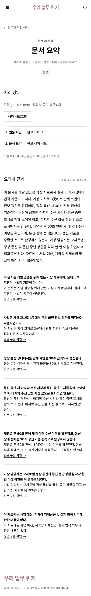

# 9단계 실제 모델 기준 결과

실행일: 2026-09-09. 가상 원문 3개, 도메인 1개, 프로젝트 2개, 원문에 근거한 게시 위키 1개를 별도 개발 평가 작업공간에 준비했다. 원문·위키는 작성 계정으로 등록하고 다른 검토 계정으로 공개했다. 질문은 이용 직원 역할로 실행했다.

[원본 결과](results.json)는 원문 파일 해시·실제 버전 ID·근거 문단·질문 범위·모델·설정 지문·시간·토큰을 포함한다. 후속 비교에서 이 기준 파일을 덮어쓰지 않는다. 재현 명령은 `node scripts/evaluate-core.mjs <새-단계-이름>`이다. 로컬 평가 계정과 작업공간 연결 정보는 `.local`에만 보관하고, 비밀번호·키·접속 비밀은 보고서에 쓰지 않는다.

## 실행 결과

| 항목 | 결과 |
| --- | --- |
| 실제 모델 | OpenAI `gpt-5.6-terra`, 실제 임베딩 색인 사용 |
| 고정 질문 | 9/9 응답 완료. 후속 질문의 선행 응답을 포함한 실제 대화 호출 10회 |
| 기대 근거 | 답변 가능 질문 6개의 기대 원문 구절 7/7을 상위 최대 8개 근거에서 확인 |
| 검색 경로 | 결합 검색 8개, 키워드 검색 1개. 색인이 있어도 해당 질문의 벡터 유사도 조건을 통과한 후보가 없으면 키워드 경로 사용 |
| 근거 링크 | 실제 답변이 사용한 출처 26개 모두 HTTP 200 |
| 질문 소요 시간 | 1.64~5.63초, 중앙값 3.36초. 후속 질문 항목은 선행 호출 시간을 포함 |
| 대화 사용량 | 10회 합계 입력 8,001 / 출력 986 토큰 |
| 기존 단일 변경안 | 공개 원문을 근거로 기존 위키 보완안 1개 생성, 검토 전 초안 상태 유지. 입력 851 / 출력 517 토큰 |
| 새 백그라운드 요약 | 추출 문단 6/6 처리, 실제 원문 인용 7개 검증. 입력 868 / 출력 871 토큰 |
| 화면 | 원문·작업 상세 각각 1440/390px, 4개 조합 모두 정상 응답·가로 넘침 없음 |
| 비용 | 단가 미설정으로 금액을 확정하지 않음 |
| 실제 업무 판정 | 미검증. 고객 원문·업무 담당자의 검토 없음 |

## 내용 대조와 발견 사항

개발 원문과 대조해 30초 정상 갱신, 통신 중단 시 최신 값으로 표시하면 안 된다는 부정문, 재연결 후 60초 확인을 유지했다. 다른 프로젝트의 10초 기준을 새봄시의 변경 결정으로 적용하지 않았고, 현장 기록을 작성자 진술 및 검토 중 상태로 표현했다. 예산·법적 의무·변경 승인 여부를 자료만으로 확정하지 않았다.

Q09의 기준 답변에서 추가 확인 권고에 관련 없는 검수 문단 `[E5]`를 붙인 문제가 있었다. 채팅 지시문을 수정해 직접 확인한 사실에만 해당 근거를 붙이고, 확인 불가 안내·권고에 무관한 인용을 붙이지 않도록 했다. [실제 모델 3회 재검증](citation-recheck.json)에서 해당 검수 문단 인용은 사라졌다. 다만 2회는 “제공된 근거에 변경 기록이 없다”는 문장에 현재 30초 기준의 출처를 붙였다. 사실을 뒤집지는 않았지만 문장별 근거 적합성의 남은 개선 대상으로 13·16단계에서 다시 검사한다. 이 결과를 모든 인용의 의미가 자동 검증되었다는 뜻으로 해석하지 않는다.

기존 단일 변경안은 하나의 위키를 문서 전체 안내로 넓히는 결과를 냈다. 원문 내용은 유지했지만 여러 주제로 나누는 유용성은 11단계와 비교한다. 9단계 요약은 작은 문서 전체를 한 번에 읽는 검증이며 긴 문서 분할 분석의 완료가 아니다.

