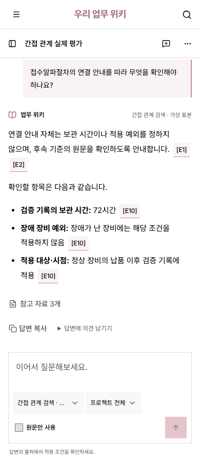

# 실제 모델의 간접 관계 비교

2026-09-09. 반복되는 가상 목차 90문단, 연결 설명 원문 1문단, 후속 기준 원문 1문단, 게시 위키 3개를 준비했다. 작성 계정의 등록·게시 요청과 별도 검토 계정의 승인을 거쳤다. 목차 위키 → 연결 안내 위키 → 후속 기준 위키로 연결했다. 원문 문단과 현재 위키 95/95개의 의미 색인을 확인했다.

질문: “접수알파절차의 연결 안내를 따라 무엇을 확인해야 하나요?”

| 범위 | 실제 결과 |
| --- | --- |
| 일반 질문 | 기본 상위 E1~E8에는 후속 원문이 없음. 관계로 E9 연결 설명과 E10 후속 기준을 추가. E10의 72시간 보관, 장애 장비 제외, 정상 장비 납품 이후 적용을 답변에 유지 |
| 원문만 사용 | 위키·관계 확장을 제외. 목차 원문만 찾아 세부 기간·예외를 확인할 수 없다고 답하며 72시간을 생성하지 않음 |

실제 `gpt-5.6-terra` 호출 2회, 입력 3,916 / 출력 233토큰. 소요 시간은 일반 질문 3.573초, 원문만 사용 2.539초였다. 사용한 근거 링크 4개는 모두 HTTP 200, 390px 두 화면에서 넘침·브라우저 오류가 없었다. [원본 결과](results.json)에 현재 버전·원문 위치·네 관계 신호와 중간 노드의 버전을 보존했다.

실행 중 근거 10개를 DB에서 읽을 때 E10이 E2보다 앞에 놓이는 정렬 문제를 발견했다. 검색 자체는 E10으로 추가했지만 재조회 목록은 문자열 순서였다. 숫자 순서로 수정하고 기존 상위 8개와 추가 근거 순서를 재검증했다. 최초 [실패 기록](failure-1788961807042.json)도 유지한다. 평가 준비 시 목차의 제목 문단 대신 설명 문단을 연결하도록 공식 위키 변경안으로 수정한 뒤 최종 실행했다.

이 결과는 관계 검색이 유용한 가상 표본의 기능 확인이다. 관계가 있다는 이유만으로 모든 문서의 적용 조건이 같다고 판단하거나, 실제 고객 업무 품질이 검증됐다고 해석하지 않는다.

재현: `node scripts/evaluate-graph-relevance.mjs`. 이미 완료된 결과 파일이 있으면 덮어쓰기를 거절한다.

