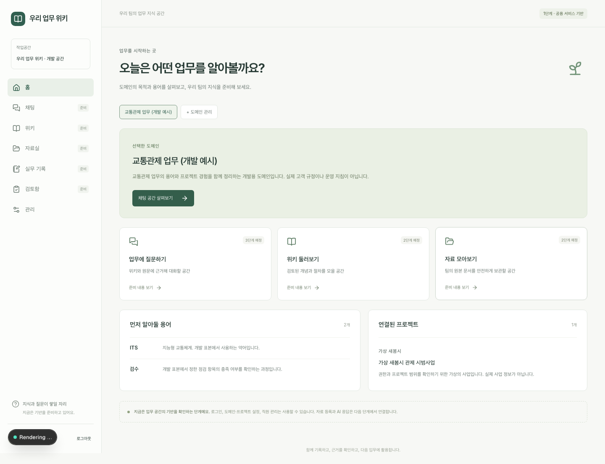

# 1단계 — 공용 서비스 기반

작성일: 2026-09-08. 대상 프로젝트: `my-domain-wiki`.

1단계 P1-01~P1-05의 구현·검증 기록이다. **여기서 사용자 확인을 기다리며, 2단계 구현은 시작하지 않는다.** 검사 결과와 제한 사항은 [검증 문서](VERIFICATION.md)에 별도로 기록한다.

## 사용할 수 있는 기능

| 기능 | 현재 동작 |
| --- | --- |
| 로그인·로그아웃 | 관리자 제공 이메일·비밀번호로 로그인. 공개 가입 차단. 로그아웃 시 서버 세션 삭제 |
| 작업공간·역할 | 요청마다 세션과 현재 소속·이용 상태 확인. 이용·작성·검토 역할과 관리자 권한을 별도 저장 |
| 한국어 업무 홈 | 도메인 선택, 목적·핵심 용어·연결 프로젝트 조회 |
| 도메인 관리 | 이름·목적·용어·실무 기록 기본 양식 생성·수정 |
| 프로젝트 관리 | 도메인에 연결된 프로젝트 이름·발주처 이름·설명 생성·수정 |
| 직원 관리 | 계정 생성, 업무 역할·관리자 권한 변경, 이용 중지·재활성화 |
| 모델 설정 기반 | 서버 환경 변수만 읽음. 관리 화면에는 입력 여부만 표시. 실제 모델 호출 없음 |
| 평가 입력 | 가상 원문 3개, 질문 9개, 기대 구절·위치·적용 범위, 답변 불가 사례 3개 |

일곱 메뉴는 홈·채팅·위키·자료실·실무 기록·검토함·관리다. 이용·작성 직원에게는 검토함·관리를 표시하지 않는다. 검토 직원은 검토함, 관리자는 관리와 검토 준비 화면을 볼 수 있다. 관리자 권한만으로 향후 게시 승인 권한을 자동 부여하는 것은 아니며, 검토 업무는 별도 역할로 관리한다.

채팅·위키·자료실·실무 기록·검토함은 구현 예정 단계와 준비 내용을 표시한다. 채팅 입력·전송은 비활성 상태다. 저장한 실무 기록 양식도 아직 작성 흐름에는 연결하지 않았다.

## 처음 실행하기

확인한 환경은 Node.js **22.23.1**, npm **12.0.2**, Docker **28.4.0**, Compose **2.39.2**다.

```bash
cd ~/Dev/Private/my-domain-wiki
npm ci
npm run setup:local
npm run db:up
npm run db:migrate
npm run db:bootstrap
npm run dev
```

1. `setup:local`은 무작위 DB 비밀번호·인증 비밀을 `.env.local`에 생성한다. 이미 존재하면 덮어쓰지 않는다. 예시는 `.env.example`에 있다.
2. `db:up`은 전용 Docker 프로젝트 `my-domain-wiki`를 시작하고 개발·시험 DB와 일반 접속 계정을 준비한다. 웹 서버에는 PostgreSQL 슈퍼유저를 사용하지 않는다.
3. `db:migrate`는 체크인된 `drizzle/0000_foundation.sql`을 적용한다. 재실행 시 적용 이력으로 중복 실행을 피한다.
4. `db:bootstrap`은 개발 작업공간·예시 도메인·예시 프로젝트와 관리자·이용 직원 계정을 만든다. 로그인 정보는 `.local/initial-accounts.json`에 권한 `0600`으로 저장한다. 공개된 공통 기본 비밀번호는 없다.
5. [http://localhost:3000](http://localhost:3000)으로 접속한다. 접속 주소는 `BETTER_AUTH_URL`과 일치해야 한다. `127.0.0.1` 주소를 사용할 때에는 설정도 함께 맞춘다.

`npm run dev`와 `npm run start`는 먼저 환경 변수 형식·필수 항목을 검사한다. 비밀 값은 오류 메시지에 출력하지 않는다.

기본 포트는 웹 `3000`, DB `127.0.0.1:55433`, 통합시험 웹 `3101`이다. DB 포트를 바꾸면 `.env.local`의 `DB_PORT`, `DATABASE_URL`, `TEST_DATABASE_URL`을 함께 변경한다. PostgreSQL 볼륨 이름은 `my-domain-wiki_postgres_data`다.

DB를 다시 사용할 때에는 `npm run db:up`, 중지할 때에는 `npm run db:stop`을 실행한다. 중지해도 저장한 내용은 유지된다. 이미 생성된 DB의 비밀번호는 `.env.local`만 바꿔서 변경되지 않는다.

초기 계정이 있으면 bootstrap은 비밀번호와 데이터를 유지한다. DB를 별도로 재생성했는데 기존 초기 계정 파일이 남아 있으면 계정 파일을 덮어쓰기 전에 중단한다. 기존 파일을 별도 보관한 뒤 의도한 새 환경에서 다시 실행한다. 개발용 bootstrap은 `NODE_ENV=production`에서 실행되지 않는다.

## 화면에서 확인하는 순서

1. 초기 관리자 계정으로 로그인한다. 홈에서 개발 예시 도메인·용어·프로젝트를 확인한다.
2. **관리 → 업무 도메인 → 수정**을 열어 목적과 용어를 바꾼다. 저장하고 홈을 새로 열어 반영을 확인한다. 용어는 한 줄에 `용어 | 설명` 형식이다.
3. 프로젝트를 생성하거나 기존 프로젝트의 설명을 수정한다. 다른 도메인을 만들면 도메인별로 프로젝트가 나뉘어 표시된다.
4. **직원 계정 생성**에서 새 이메일·12자 이상 비밀번호·역할을 입력한다. 비밀번호는 저장 후 다시 표시하지 않으므로 직원에게 안전하게 전달한다.
5. 다른 브라우저나 시크릿 창에서 이용 직원으로 로그인한다. 관리 메뉴가 보이지 않으며 관리 API와 직접 관리 주소도 거부된다.
6. 관리자 창에서 해당 직원의 이용 상태를 중지한다. 직원 창에서 새 요청을 보내면 접근할 수 없다. 재활성화 후에는 다시 로그인해야 한다.
7. 채팅으로 이동해 준비 안내와 비활성 입력 상태를 확인한다. 아직 AI 응답은 생성하지 않는다.

데스크톱 홈은 초기 개발 예시로, 모바일 화면은 자동 통합시험의 가상 데이터로 촬영했다.



[모바일 채팅 준비 화면](screenshots/mobile-chat.png)

## 데이터·서버 구조

| 파일·영역 | 역할 |
| --- | --- |
| `compose.yaml`, `scripts/init-local-db.mjs` | 개발 PostgreSQL·일반 DB 계정·시험 DB |
| `src/server/db/schema.ts`, `drizzle/` | 인증 4개·업무 4개 테이블과 마이그레이션 |
| `src/server/env.ts`, `src/server/auth.ts` | 서버 설정·Better Auth·가입 차단·세션 생성 검사 |
| `src/server/access.ts` | 페이지·API에서 사용하는 인증·현재 작업공간 권한 검사 |
| `src/server/services/workspace.ts` | 권한을 확인하는 도메인·프로젝트·직원 업무 서비스 |
| `src/server/http.ts` | JSON·요청 출처·크기 제한·비밀을 제외한 오류 응답 |
| `src/app/w/[workspaceId]/` | 홈·관리·준비 화면. 페이지별 권한도 별도로 확인 |
| `tests/foundation.spec.ts` | PostgreSQL과 실제 브라우저를 사용하는 통합시험 |
| `docs/evaluation/` | 향후 파서·검색·응답 평가에 쓸 원문·질문 목록 |

인증 데이터는 `app_user`, `auth_account`, `auth_session`, `auth_verification`에 저장한다. 업무 데이터는 `workspace`, `membership`, `domain`, `project`에 저장한다. 프로젝트의 작업공간·도메인 관계는 복합 외래키로도 제한한다. 발주처는 현재 프로젝트의 이름 필드이며 별도 발주처 관리 기능은 아직 없다.

이용 중지는 해당 작업공간의 소속을 비활성화하고 그 계정의 모든 로그인 세션을 삭제한다. 다른 활성 소속이 있다면 재로그인 후 그 공간은 계속 이용할 수 있다. 현재 화면에서는 작업공간 추가 생성이나 기존 이메일의 다른 공간 초대 기능을 제공하지 않는다.

자기 관리자 권한 해제·자기 이용 중지는 다른 관리자가 처리해야 한다. 관리 권한 변경은 작업공간 행을 잠그는 트랜잭션 안에서 재검사해 동시 변경으로 마지막 관리자를 제거하지 못하게 한다.

주요 API는 다음과 같다. `/api/auth/*`는 Better Auth가 처리하며, 그 외 변경 API는 로그인 쿠키와 일치하는 `Origin`, JSON 요청이 필요하다.

| 경로 | 동작 |
| --- | --- |
| `GET /api/health` | DB 연결 확인, 정상 200·연결 실패 503 |
| `GET /api/workspaces/:workspaceId` | 소속 공간의 도메인·프로젝트 조회 |
| `POST /api/workspaces/:workspaceId/domains` | 관리자 도메인 생성 |
| `PATCH /api/workspaces/:workspaceId/domains/:id` | 관리자 도메인 수정 |
| `POST /api/workspaces/:workspaceId/projects` | 관리자 프로젝트 생성 |
| `PATCH /api/workspaces/:workspaceId/projects/:id` | 관리자 프로젝트 수정 |
| `GET/POST /api/workspaces/:workspaceId/members` | 관리자 직원 목록·계정 생성 |
| `PATCH /api/workspaces/:workspaceId/members/:id` | 관리자 역할·이용 상태 변경 |

비로그인 401, 권한 부족 403, 소속 없는 공간·다른 공간의 ID 404, 입력 오류 400, 중복·자기 잠금 409, 본문 64KiB 초과 413으로 응답한다.

모델 관련 `AI_BASE_URL`, `AI_MODEL`, `AI_API_KEY`는 전부 비우거나 세 항목을 함께 입력한다. `server-only` 경계 안에서만 읽고 클라이언트 컴포넌트에 전달하지 않는다. 설정 입력 여부와 실제 연결 검증은 구분한다.

## 다음 단계로 넘길 사항

2단계 대상은 원본 업로드·버전·공개 범위, 영속 작업 큐, 파서 비교, 위키 편집·검토·게시, 기본 검색이다. 현재 생성한 업무 ID와 권한 서비스를 사용한다. 실제 고객 자료의 필수 형식과 대표 질문은 [평가 기준](../../evaluation/README.md)에 따라 확인한다.

이 문서는 1단계에 한정한다. 이후 단계의 작업 내용과 검증 결과는 각 단계의 별도 디렉터리에 작성한다.
