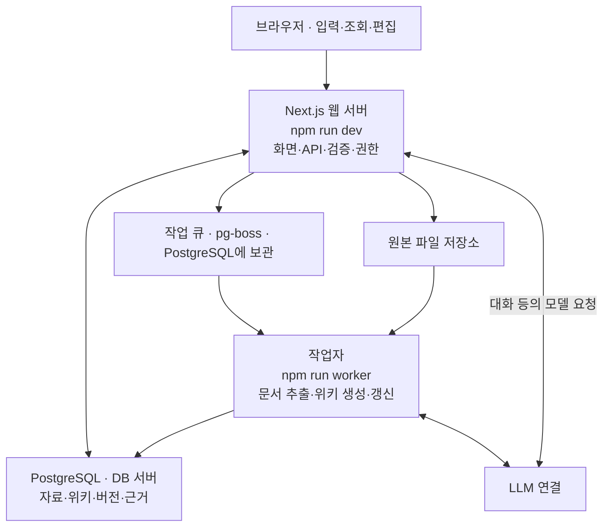

# 프로젝트 업무·기술·아키텍처 안내

이 안내는 [domain-wiki 저장소](https://github.com/jikime/domain-wiki)를 우리 업무에 맞게 확장할 때 사용하는 공통 지도입니다. [1단계](weeks/01-experience.md)에서 기본 도구 설치와 [첫 실행](getting-started.md)을 함께 마치고, 이후 같은 환경에서 **업무 요구사항 정리 → AI의 변경 계획 확인 → AI 구현·검사 → 교육생의 실제 결과 확인 → 보완 요청**을 반복합니다.

기술을 설명할 때는 이 프로젝트에서 어디에, 왜 쓰는지 짚습니다. 문법 연습, 함수·검증 코드 직접 작성, 코드 한 줄씩 해설, 테스트 코드 작성은 교육생 과제가 아닙니다. 교육생은 원하는 동작과 완료 기준을 정하고 결과를 판단합니다. 코드 조사·수정·기술적 검사는 개발용 AI가 담당합니다.

**읽는 순서:** 이번 단계 교재의 실습을 먼저 진행하고, 여기서는 강사가 설명하는 부분이나 지금 궁금한 항목을 찾아봅니다. 기술 표·구조도·코드 위치는 역할을 이해하는 참고이며, 내용을 전부 외우거나 코드 링크를 모두 읽는 과제가 아닙니다. 처음이라면 [실습 길잡이](start-here.md)부터 확인하세요.

## 1. 프로젝트를 구성하는 부분



이 그림으로 각 부분의 역할을 살펴봅니다. 브라우저와 웹 서버, 작업자, DB는 맡은 일이 다르지만 같은 컴퓨터에서 실행할 수도 있습니다. 웹 서버와 작업자는 별도 실행 프로그램입니다. Next.js의 화면 구성에는 서버에서 실행하는 부분도 있으므로 화면 파일을 모두 브라우저 코드라고 설명하지 않습니다.

설정 저장은 웹 서버가 바로 처리하고, 문서 추출·위키 생성처럼 오래 걸리는 일은 작업 큐에 등록해 작업자가 처리합니다. 웹 화면이 열려도 작업자가 멈추면 문서 처리가 대기할 수 있습니다. 채팅 등 웹 서버에서 모델을 부르는 흐름도 있습니다.

### 실행 명령과 세 가지 구성

**기본 실행 구성은 웹 서버·작업자·DB입니다.** `npm run dev`는 프런트엔드 화면과 API 백엔드를 함께 제공하고, `npm run worker`는 백그라운드 작업을 처리합니다. 프런트엔드와 백엔드를 두 명령으로 하나씩 나눈 구조로 설명하지 않습니다.

| 실행 구성 | 하는 일 | 기본 로컬 환경에서 확인할 것 |
| --- | --- | --- |
| `npm run dev` · Next.js 웹 서버 | 화면 제공, 로그인, 저장·조회 API, 권한 검사, 채팅 요청 처리 | 브라우저 접속 주소는 `http://localhost:3010` |
| `npm run worker` · 작업자 | 문서 추출, 위키 생성·갱신, 임베딩 색인, 품질 점검 | 별도 사용자 접속용 HTTP 포트 없이 대기 작업을 처리 |
| PostgreSQL · DB 서버 | 사용자·자료·위키·벡터·작업 큐 보관 | 사전에 준비한 DB 사용, 기본 로컬 연결 포트는 `55433` |

로컬 실습에서는 DB를 Docker로 준비하고 웹 서버·작업자는 Node.js로 실행합니다. 위 포트는 개발 기본값이며 원격 환경에서는 강사가 제공한 접속·DB 설정을 따릅니다. `dev`는 개발용 실행이고 운영용 웹 서버 실행은 빌드 후 `start`를 사용합니다. 운영 배포 절차는 이번 설명의 실습 범위에 넣지 않습니다.

그림의 박스는 기능별 역할을 보여 줍니다. 다음 구성은 실행 프로그램·외부 연결·저장 위치로 구분합니다.

| 관련 구성 | 별도로 실행할 서버가 필요한가? |
| --- | --- |
| pgvector | PostgreSQL 안에 설치된 확장 기능이므로 별도 벡터 서버를 실행하지 않음 |
| pg-boss 작업 큐 | 같은 PostgreSQL에 작업을 보관하므로 별도 Redis·메시지 큐 서버가 필요하지 않음 |
| OpenAI 모델 | 현재 API 설정에서는 외부 서비스를 호출하므로 로컬 모델 서버를 실행하지 않음 |
| 원본 파일 | 설정된 파일 경로에 보관하며 현재 구조에서 별도 파일 서버는 필요하지 않음 |
| MinerU 문서 추출 | 선택 기능이며 로컬 연결을 선택하면 별도 추출 서비스를 준비, 기본 수업에는 필수 아님 |

교육생은 ‘화면 접속 문제는 웹 서버·접속 주소, 문서 처리 대기는 작업자·작업 상태, 저장·로그인 오류는 DB 연결 등도 확인할 단서’로 구분합니다. 상태와 오류 메시지를 AI·강사에게 전달하고 원인은 조사 결과로 확인합니다. 실행 명령을 외우거나 서버를 새로 구현하는 과제는 두지 않습니다.

실제 구성은 [실행 스크립트](../../package.json), [로컬 DB 구성](../../compose.yaml), [작업자](../../src/worker/index.ts), [DB 기반 작업 큐](../../src/server/jobs/queue.ts)에 있습니다. 설치·실행 순서는 기존 [첫 실행 안내](getting-started.md)를 사용합니다.

## 2. 업무 기능과 확장 지도

LLM Wiki에서는 자료를 등록하고 원문을 보존한 뒤 내용을 추출합니다. 이를 바탕으로 위키를 만들고 연결해 검토와 게시를 거칩니다. 새 자료가 들어오면 위키를 갱신하고, 질문하거나 업무에 활용합니다. 기존 원문과 위키·답변을 구분하고, 무엇을 근거로 만들었는지 확인합니다.

| 업무 기능 | 현재 기능의 목적 | 수업에서 활용·확장할 방향 | 관련 코드 · AI가 찾아볼 위치 |
| --- | --- | --- | --- |
| 도메인·업무 설정 | 목적·용어·양식을 회사 업무에 맞춤 | 용어·작성 규칙 적용, AI로 동의어 입력 방식 개선 | [settings-form.tsx](../../src/components/settings-form.tsx), [workspace.ts](../../src/server/services/workspace.ts) |
| 자료 등록·처리 | 파일·실무 기록을 근거 자료로 보관 | 원문·처리 상태 확인, 작성 안내 개선 | [record-editor.tsx](../../src/components/record-editor.tsx), [sources.ts](../../src/server/services/sources.ts), [extract.ts](../../src/server/jobs/extract.ts) |
| 위키 생성 | 원문과 업무 기준으로 초안을 구성 | 업무별 위키 구조·생성 규칙 적용 | [wiki-editor.tsx](../../src/components/wiki-editor.tsx), [wiki-generation.ts](../../src/server/ai/wiki-generation.ts) |
| 갱신·검토 | 새 자료를 반영하고 검토된 버전을 게시 | 생성 결과 비교, 원문 개정과 근거 갱신 확인 | [wiki.ts](../../src/server/services/wiki.ts), [wiki-merge.ts](../../src/server/ai/wiki-merge.ts) |
| 지식 연결 | 관련 위키와 출처를 따라가며 확인 | 관련 문서·근거 누락 점검, 연결 표시 개선 후보 정리 | [wiki-links.ts](../../src/lib/wiki-links.ts), [wiki-references.ts](../../src/server/services/wiki-references.ts) |
| 질문·답변·재사용 | 위키·원문으로 답하고 유용한 결과를 위키에 저장 | 질문 범위·인용 확인, 답변의 위키 초안 저장 체험 | [chat.ts](../../src/server/services/chat.ts), [chat-wiki.ts](../../src/server/services/chat-wiki.ts) |
| 품질·업무 적용 | 누락·상충·오래된 근거를 확인하고 업무 문서에 활용 | 검수 조건 검토, RFP 확인 질문·실무 메모 표시 개선 | [quality.ts](../../src/server/jobs/quality.ts), [rfp-editor.tsx](../../src/components/rfp-editor.tsx) |

위 표의 기능은 스타터킷에서 재사용할 기반입니다. 모든 행에 새 기능을 만드는 과제를 붙이지 않습니다. 공통 코드 확장은 동의어 입력 개선으로 범위를 좁히고, 위키 생성·검토·갱신은 같은 업무 자료로 계속 활용합니다. 7단계에서는 팀별 작은 표시 기능 한 가지를 AI와 추가합니다. 새 확장 후보는 이미 구현되어 있는지와 필요한 작업 범위를 AI가 먼저 확인합니다.

## 3. 사용 기술의 목적과 용도

| 기술 | 이 프로젝트에서 사용하는 이유 | 교육생이 활용할 때의 관점 |
| --- | --- | --- |
| Next.js·React | 페이지와 입력 화면을 구성하고 서버 처리와 연결 | 어떤 화면에서 무엇이 입력·표시되어야 하는지 요청 |
| Tailwind CSS·shadcn/ui | 기존 스타일과 버튼·입력창 등 공통 부품을 재사용 | 기존 화면과 어울리는 구성·안내 요청 |
| TypeScript | 코드에서 값의 형태를 명확히 하고 개발 중 오류 확인 지원 | AI가 수정 후 형태 검사를 수행했는지 결과 확인 |
| Zod | 실제 전달된 값의 필수 조건·길이·형식 검사 | 제목 필수, 허용 길이 등 업무 입력 조건 전달 |
| HTTP API·JSON | 화면과 서버가 정해진 구조로 요청·결과를 전달 | 저장·조회할 정보와 성공·실패 시 기대 동작 설명 |
| PostgreSQL·Drizzle | 사용자·자료·위키·버전·관계 정보를 저장·조회 | 새 정보가 저장 후 다시 열어도 유지되어야 한다고 요청 |
| Node.js·pg-boss·작업자 | 웹 서버 실행과 오래 걸리는 문서·AI 작업 처리 | 대기·진행·완료·실패 중 어떤 상태인지 확인 |
| LLM 연결·프롬프트 | 원문·목적·작성 규칙을 모델에 전달하고 생성 결과를 수신 | 어떤 자료를 바탕으로 어떤 위키를 만들지 지정 |
| Markdown·편집기 | 위키 본문·제목·목록·링크를 표현하고 편집 | 업무 문서의 구성과 읽기 편한 표현 결정 |
| Better Auth·업무 권한 검사 | 로그인 확인과 작업공간·작성·검토 권한 제어 | 어떤 역할이 조회·작성·검토할 수 있어야 하는지 설명 |
| OpenAI 임베딩·키워드 검색·pgvector | 글을 벡터로 변환하고 단어·의미 유사도로 필요한 자료 탐색 | 모델의 벡터 생성과 pgvector의 저장·비교 역할을 구분 |
| Git·형식 검사·타입 검사·테스트 | 변경을 기록하고 코드의 오류·기존 동작 확인 | AI에게 변경 범위·검사 결과·미확인 항목 정리 요청 |

기술 이름을 외우거나 사용 예제를 직접 구현하는 과제는 없습니다. 예를 들어 Zod는 ‘잘못된 입력을 막는 데 사용한다’고 설명한 뒤, 교육생은 ‘제목을 비우면 저장하지 말고 이유를 안내해 줘. 기존 검증 방식을 사용해 줘’처럼 AI에게 요청하면 됩니다. 필요한 코드 위치와 구체적인 구현 방법은 AI가 찾습니다.

DB의 표·관계와 입력 검증 규칙, 위키 작성 양식은 모두 ‘스키마’라고 부를 수 있지만 대상이 다릅니다. 작성 양식에 항목을 적는 것만으로 DB 필드가 생기지는 않습니다. 새 저장 항목이 필요한 경우에는 AI가 화면·API·검증·DB에 미치는 영향을 계획에 설명해야 합니다.

### 현재 임베딩 모델과 pgvector

확인된 교육 준비 환경은 **OpenAI의 `text-embedding-3-small`로 벡터를 만들고 PostgreSQL의 pgvector로 저장·유사도 비교**를 하도록 설정되어 있습니다. 모델 이름은 현재 설정의 예이며 고정된 필수 모델은 아닙니다. 수업 환경의 모델은 강사가 준비 단계에서 확인합니다.

| 구성 | 이 프로젝트에서 맡은 일 |
| --- | --- |
| OpenAI 임베딩 모델 | 글의 의미를 비교할 수 있도록 숫자 배열인 벡터로 변환 |
| PostgreSQL의 pgvector 확장 | 변환된 벡터를 DB에 저장하고 질문 벡터와의 유사도 비교 |
| domain-wiki 작업자·서버 | OpenAI 임베딩 API를 호출하고 벡터 저장·검색·근거 전달을 연결 |

**자료를 준비할 때:** 공개된 원문 문단·게시된 위키 → 작업자가 OpenAI 임베딩 API 호출 → 생성된 벡터를 PostgreSQL에 저장합니다.

**질문할 때:** 사용자 질문 → 서버가 같은 임베딩 모델로 질문을 벡터로 변환 → pgvector가 저장된 벡터와 비교 → 키워드 검색 결과와 함께 관련 자료를 선택 → 답변 생성 모델에 근거로 전달합니다.

임베딩 모델은 검색을 위한 숫자를 만들고, 답변 생성 모델은 선택된 근거로 설명을 작성합니다. 예를 들어 ‘기록을 얼마나 보관하나요?’라는 질문으로 ‘이력 저장 기간’에 관한 자료를 찾는 데 의미 검색이 도움을 줍니다. 검색된 내용의 사실·범위·현재 버전은 교육생이 원문으로 확인합니다.

임베딩이 미설정이거나 호출에 실패하면 키워드 검색을 사용합니다. 위키 생성·갱신과 의미 검색의 역할을 구분하며, 이 설명에 API 호출 코드·벡터 저장·검색 구현 과제는 붙이지 않습니다. 모델 연결·검사와 필요한 코드 변경은 AI·강사가 담당합니다.

현재 연결의 확인 위치는 [모델 설정](../../src/server/env.ts), [임베딩 API 호출](../../src/server/ai/client.ts), [공개 자료의 벡터 저장](../../src/server/ai/knowledge-index.ts), [질문 검색](../../src/server/services/retrieval.ts)입니다. 교육생은 파일 내용을 직접 구현하거나 문법을 해설할 필요가 없습니다.

## 4. 아키텍처에서 이해할 여섯 가지 관계

1. **실행 위치:** 브라우저·웹 서버·작업자·DB·원본 저장소·모델의 역할을 구분합니다.
2. **요청 흐름:** 화면 입력 → API → 서비스의 권한·입력 확인 → 저장 → 결과 표시를 따라갑니다. [src/components](../../src/components), [API](../../src/app/api/workspaces), [서비스](../../src/server/services)는 AI가 변경 위치를 설명할 때 사용하는 지도입니다.
3. **데이터 관계:** 작업공간 안에 도메인·프로젝트와 자료가 있고, 원문 버전·위키 버전·근거가 연결됩니다. 프로젝트 구분은 검색 범위이며 사용자별 비밀 공간을 자동으로 만드는 것은 아닙니다. 구조는 [schema.ts](../../src/server/db/schema.ts)에 있습니다.
4. **원문과 갱신:** 원문을 근거로 보존하면서 위키를 생성·수정합니다. 새 원문 공개와 새 위키 게시가 같은 동작은 아닙니다. 버전·출처·검토 상태를 함께 확인합니다.
5. **오래 걸리는 처리:** 작업 큐는 처리할 일을 보관하고 작업자는 이를 실행합니다. 대기·실패 원인은 상태·로그를 AI나 강사에게 전달해 확인합니다. [작업자](../../src/worker/index.ts), [큐](../../src/server/jobs/queue.ts)를 참고합니다.
6. **검색과 답변:** 관련 위키·원문을 찾아 답변 문맥으로 제공하는 부분이 RAG에 해당합니다. LLM Wiki를 생성·유지하는 데 임베딩 기반 RAG를 먼저 구축할 필요는 없습니다. 현재 [retrieval.ts](../../src/server/services/retrieval.ts)는 임베딩이 설정되지 않으면 키워드 검색을 사용합니다.

이론 설명 뒤에는 ‘이 변경은 화면·저장·생성·검토 중 어디에 영향을 줄까요?’를 묻습니다. 교육생이 함수 호출이나 자료형 문법을 설명하는 과제는 두지 않습니다.

## 5. 교육생과 AI가 맡는 일

| 단계 | 교육생 | 개발용 AI |
| --- | --- | --- |
| 요구 정리 | 현재 문제·기대 결과·완료 기준 결정 | 모호한 조건과 기존 기능 확인 |
| 변경 계획 | 업무 의도와 범위가 맞는지 판단 | 현재 코드·설치 버전 조사, 수정 위치·영향 설명 |
| 구현 | 필요한 추가 조건 전달 | 파일 수정·함수 연결·검증 규칙·필요한 검사 작성 |
| 검증 | 실제 화면 조작, 원문과 결과 비교 | 관련 검사 실행, 오류 수정, 변경 내역·실행 결과 보고 |
| 보완·인계 | 부족한 결과에 수정 지시, 업무 활용 방법·남은 문제 기록 | 결과 코드 위치·검사·복구 절차 정리 |

**개발용 AI**는 이 프로젝트의 코드를 읽고 고치는 도구이고, **서비스 AI**는 domain-wiki 안에서 위키·답변을 만드는 기능입니다. 수업에는 둘 다 준비합니다. AI에게 구현을 맡기는 것은 기본 수행 방식이며 도움을 받은 것으로 감점하지 않습니다.

처음 요청문을 쓰는 경우에는 [프롬프트 작성·실행 연습](prompt-practice.md)을 사용합니다. 어떤 상황에서 무엇을 이루려는지, 원하는 결과는 무엇인지 자신의 말로 적습니다. 지켜야 할 조건과 확인 방법도 함께 적고 첫 결과를 확인한 뒤 조건 하나를 보완해 다시 실행합니다. 아래 예시는 직접 작성한 초안과 비교하는 참고입니다.

요청 예시:

```text
교육용 domain-wiki의 동의어 입력을 개선해 주세요.
현재는 세미콜론으로 나눈 두 용어가 한 항목으로 저장됩니다.
쉼표·전각 쉼표·세미콜론을 모두 지원하고 공백·빈 항목·정확한 중복을 정리해 주세요.
기존 용어 설명, 저장 제한과 권한, 화면 스타일은 유지해 주세요.
먼저 현재 코드를 확인해 재사용할 기능과 변경 범위·확인 방법을 설명해 주세요.
계획을 확인한 뒤 구현을 요청하겠습니다.
```

계획이 업무 의도와 맞으면 다음처럼 요청합니다.

```text
설명한 범위로 구현하고 필요한 검사를 실행해 주세요.
수정한 파일의 역할, 달라진 사용자 동작, 검사 결과와 미확인 항목을 정리해 주세요.
제가 화면에서 확인할 입력과 기대 결과도 알려 주세요.
```

파일 이름을 모르면 사용한 화면과 재현 입력부터 알려 줍니다. 코드 검색·기술 문서 조사는 AI에게 맡기고, 교육생은 설명한 변경이 업무 요구와 맞는지 판단합니다. [T3 요청 양식](templates.md#t3-ai-개발-요청)을 활용합니다.

## 6. 결과 확인과 저장

AI에게 필요한 형식·타입·입력 검사를 실행하고, 실제 수정한 파일의 변경 내역과 실패·미실행 결과를 정리하도록 요청합니다. 명령 입력과 테스트 코드 작성은 교육생의 필수 활동이 아닙니다. 코드 검사 통과와 실제 업무 결과 확인은 별도로 남깁니다.

교육생은 화면에서 정상 입력·빈 값·잘못된 입력을 확인하고 저장 후 다시 열어 봅니다. 위키·답변은 원문의 수치·범위·출처와 비교합니다. 실패하면 재현 단계와 실제 결과를 AI에게 전달해 보완을 요청합니다. AI의 ‘완료’ 답변만으로 실습을 끝내지 않습니다.

Git 변경 확인과 결과 커밋·보관도 AI에게 요청할 수 있습니다. AI는 기존 다른 변경과 비밀 값을 섞지 않고 해당 과제의 결과만 정리합니다. 교육생은 결과 위치와 확인 방법을 인계 카드에 남깁니다. 원격 제출은 강사가 지정한 저장소·브랜치를 사용하며, 제출하지 않았다면 로컬 보관으로 표시합니다. 파일 이력과 DB·원본 자료 상태는 별도입니다.

## 7. 강의 배치와 선택 심화

1단계에서는 기본 도구를 설치하고 개인 위키를 실행하며 도구의 목적과 실행 역할을 살펴봅니다. 자료를 등록하고 위키를 만든 뒤 질문하는 흐름을 실제 사용으로 확인합니다. 2단계에서는 기술의 목적, 실행과 데이터 흐름, 서비스 모델 연결을 설명합니다. 이어서 AI의 구조 설명을 읽고 업무 동작과 연결한 뒤, AI에게 첫 변경을 요청하고 결과를 확인합니다.

3단계 이후에는 실습 중 필요한 기술의 역할을 다시 짚습니다. 별도 기술별 코딩 수업이나 추가 숙제는 두지 않습니다.

벡터 검색 고도화, Rust 문서 추출기 내부 구현, 별도 인증 체계·대규모 DB 변경·배포 자동화는 공통 실습에 포함하지 않습니다. 이 프로젝트의 보조 기술·확장 후보로 소개하고 필요하면 후속 과제로 남깁니다. 기술 문서의 설치 버전 대조와 사용법 확인은 AI·강사가 수행합니다. 업무 사실을 판단할 때에는 교육생이 실제 원문을 확인합니다.

## 8. 모델 연결의 현재 기능과 설정 화면 권장안

`streamModel`은 대화·지식 생성·이미지 설명에 공통으로 사용하는 호출 함수입니다. 용도별 설정을 확인한 뒤 API이면 HTTP 스트림을 읽고, CLI이면 서버에 설치된 실행 파일을 새 자식 프로세스로 실행합니다. 권한·근거 검색·검토는 기존 위키 서버의 흐름을 거칩니다. 임베딩과 Tavily 등 웹 검색은 기존 API 연결을 사용합니다.

| 항목 | 현재 구현 | 후속 설정 화면 권장안 · 미구현 |
| --- | --- | --- |
| 연결 선택 | 환경 변수의 공통값과 용도별 덮어쓰기 | 운영자가 연결을 등록하고 회사 관리자가 허용된 연결을 선택·저장 |
| 모델·인증 | 모델·API 설정 또는 서버 계정의 CLI 인증 | 연결·모델·인증·과금·사용 범위를 함께 표시, 확인 불가는 미확인 표시 |
| 연결 확인 | 관리자 화면에서 채팅·지식 생성·임베딩 실제 응답 점검 | 연결별 상태와 마지막 검사 시각을 보존해 표시 |
| 적용 시점 | 웹 서버·작업자 재시작 | 저장한 설정을 새 요청부터 일관되게 적용 |
| 실행 제한 | CLI 동시 실행 수·시간 제한, 실패 시 API 자동 호출 없음 | 관리 가능한 한도와 실패 처리 방침을 화면에 표시 |

후속 설계에서는 DB에 회사별 선택과 관리 정보를 저장하고, 비밀 값과 CLI 인증은 서버의 관리 수단으로 분리합니다. 현재 서버 환경 변수는 같은 서버를 사용하는 작업공간에 영향을 줄 수 있으므로, 회사별 선택 화면을 추가할 때는 적용 범위와 관리 권한도 함께 구현해야 합니다. 위 표의 오른쪽 열을 현재 기능이나 필수 실습의 완료 기준으로 사용하지 않습니다.

이번 개인 PC 실습의 기본 연결은 Claude Code CLI·sonnet이며 웹 서버·작업자와 같은 사용자의 인증을 사용합니다. 회사 공용 서버에 적용할 때는 그 환경의 인증·사용 범위를 별도로 확인합니다. Claude는 개인 Free·Pro·Max 인증으로 다른 사용자의 요청을 중계하는 방식을 제한합니다. Codex는 구독·API 키 인증을 구분하고 프로그램 자동화에는 API 키 사용을 안내하며 Enterprise용 자동화 인증도 제공합니다. CLI 연결 성공만으로 이용 조건을 충족했다고 판정하지 않습니다. [Anthropic 공식 이용 안내](https://code.claude.com/docs/en/legal-and-compliance), [OpenAI 공식 인증 안내](https://learn.chatgpt.com/docs/auth)

이용 조건을 확인한 개인 교육 환경이나 강사 시연에서는 API와 CLI의 호출 경로·오류 처리를 비교할 수 있습니다. 구체적인 변수·실행 명령·현재 검증 범위는 [모델 연결 안내](../MODEL_TRANSPORTS.md)를 따릅니다. API·CLI를 같은 모델 이름으로 설정해도 기본 지침과 요청 구조가 달라 답변이 같다고 보장하지 않으며, 비교표에는 연결 방식과 모델을 함께 적습니다.
